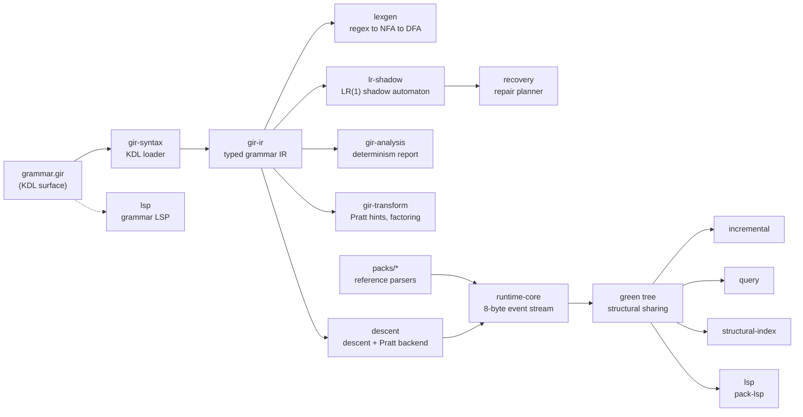

<div align="center">
  
  <p>
    <strong>A staged parser toolkit where grammars, language packs, and editors share one lossless event protocol.</strong><br/>
    Grammar packages written in a KDL surface (<code>.gir</code>) are loaded into a typed IR, compiled through a lexer
    generator and an LR(1) shadow automaton, and classified for determinism before any parser runs.
    Language packs for JSON, TOML, Python, TypeScript, Rust, C, SQL, INI, CSV, and Markdown emit the same
    packed event stream, so trees, repair planning, incremental reuse, queries, and the language servers are
    all consumers of one protocol. Built for Rust tooling authors who need byte-faithful parsing with
    editor-grade behavior: every pack is gated on losslessness, and the cookbook recipes are compiled and
    executed by the workspace test suite.
  </p>
  <p>
    <a href="https://github.com/elcoosp/syntact/actions/workflows/ci.yml"></a>
    <a href="https://github.com/elcoosp/syntact/blob/main/Cargo.toml"></a>
    <a href="https://github.com/elcoosp/syntact/blob/main/Cargo.toml"></a>
    <a href="https://doc.rust-lang.org/edition-guide/"></a>
    <a href="https://github.com/elcoosp/syntact/actions/workflows/ci.yml"></a>
    <a href="https://github.com/elcoosp/syntact/blob/main/Cargo.toml"></a>
    <a href="https://github.com/elcoosp/syntact/blob/main/docs/api-snapshot.md"></a>
  </p>
</div>

<p align="center">
  <a href="#quickstart">Quickstart</a> • <a href="#features">Features</a> • <a href="#how-it-works">How it works</a> • <a href="#usage">Usage</a> • <a href="#status">Status</a> • <a href="#learn-more">Learn more</a>
</p>

## Quickstart

Prerequisite: Rust 1.85 or newer (`rust-version = "1.85"`, edition 2024). No other tooling needed.

The fastest first win is the CLI: clone the repo, hand it the JSON grammar below, and watch the compiler
front half run. Save this as `json.gir` (the canonical grammar fixture from `crates/cli/tests/cli.rs`):

```bash
cat > json.gir <<'EOF'
language "json" version="1.0.0" extension="json"

tokens {
    number  kind=re "[0-9]+" node="true"
    string  kind=re "\"[^\"\\\\]*\"" node="true" index-bound="\""
    lbrace  kind=lit "{"
    rbrace  kind=lit "}"
    lbrack  kind=lit "["
    rbrack  kind=lit "]"
    colon   kind=lit ":"
    comma   kind=lit ","
    ws      kind=re "[ \\t\\r\\n]+" trivia="true"
}

grammar {
    value      kind=alt object array string number
    object     kind=seq lbrace pair-list rbrace node="true" reuse="true"
    pair-list  kind=sep element=pair separator="," allow-trailing="true"
    pair       kind=seq string colon value
    array      kind=seq lbrack value-list rbrack
    value-list kind=sep element=value separator=","
}
EOF
```

Then drive the pipeline:

```bash
git clone https://github.com/elcoosp/syntact && cd syntact
cargo run -p syntact -- check json.gir
# grammar `json` v1.0.0: 9 tokens, 6 rules — ok
cargo run -p syntact -- build json.gir
# per-stage stats: lexer DFA states, LR(1) shadow states, determinism verdicts
cargo run -p syntact -- conflicts json.gir
# all reachable rules deterministic (descent/pratt)
```

As a library, add the JSON pack and the runtime to your `Cargo.toml`:

```toml
[dependencies]
packs-json = { git = "https://github.com/elcoosp/syntact" }
runtime-core = { git = "https://github.com/elcoosp/syntact" }
```

Parse anything and get a lossless tree back — malformed input never fails structurally, it produces
`ERROR` nodes and a diagnostic count:

```rust
use std::sync::Arc;

use runtime_core::input::Source;
use runtime_core::tree::GreenNode;

fn main() {
    let source = r#"{"name": "syntact", "n": 42}"#;
    let tree: Arc<GreenNode> = packs_json::parse(source).expect("lossless parse");

    // Rendering the tree reproduces the source byte-for-byte.
    let input = Source::from_str_unchecked(source);
    assert_eq!(tree.render(&input), source);
    println!("parsed and rendered byte-for-byte");
}
```

> [!TIP]
> These snippets are not decorative: every cookbook recipe in `docs/cookbook/recipes/` is
> `include!`d and executed by `crates/cli/tests/docs_sync.rs`, which also checks that every code
> block in the book matches a recipe. The docs cannot rot.

## Features

- **Lossless by construction.** Parsers emit a flat 8-byte event stream (`Start`/`Token`/`Error`/`Finish`);
  trivia never rides token events, and the green tree built from the stream renders the source
  byte-for-byte — gated per pack by `syntact conformance` and differential oracles.
- **Deterministic error recovery.** A canonical LR(1) shadow automaton supplies parse states and expected
  sets to a CPCT+-shaped repair planner that uses a work budget instead of a wall clock; repairs apply as
  grammar-derived sync sets and wrap damage in `ERROR` nodes. `syntact trace` prints the repair ops per region.
- **Incremental reparsing.** The reuse engine relexes only the damaged margin window on single-token edits
  and guarantees a result indistinguishable from a fresh lex of the new source.
- **Queries over the same stream.** A tree-sitter-shaped query compiler and streaming matcher bind captures
  against any pack: `(pair (string) @key (number) @val)` compiles once and matches a packed event stream.
- **Two language servers, one binary.** `syntact lsp` serves `.gir` grammar authoring (completion, hover,
  rename with stable IDs, conflict squiggles); `syntact pack-lsp` serves diagnostics, document symbols,
  folding ranges, semantic tokens, and selection ranges for all ten pack languages — LSP 3.17 over stdio,
  std-only, with document open and didChange measured at ~1.1 ms on a ~25 KiB JSON fixture
  (`docs/book/pack-lsp.md`).
- **Budgets that run with the tests.** Criterion benches and dhat allocation-budget tests live in
  `crates/bench` and execute under `cargo test --workspace`; the workspace forbids `unsafe` code and
  enforces `missing_docs` and pedantic clippy at zero warnings.

## How it works

The compiler front half turns a `.gir` grammar package into compiler artifacts: `gir-syntax` loads the KDL
surface into the typed IR of `gir-ir`; `lexgen` compiles token regexes through NFA to a DFA with mode
support; `lr-shadow` builds the canonical LR(1) automaton; `gir-analysis` computes FIRST/FOLLOW fixpoints
and per-rule determinism verdicts; `gir-transform` lowers Pratt hints and applies factoring and inlining;
and `codegen-rust` emits O(1) tables for table-fallback regions. The runtime half consumes those artifacts:
`descent` is the descriptor-driven descent + Pratt backend, and every pack ships a reference parser that
emits the same event protocol into `runtime-core`. Downstream, `recovery` plans repairs from the shadow
automaton, and the tree builder, incremental engine, query matcher, structural index, and language servers
are all just sinks over one stream.



## Usage

### CLI

All subcommands run against the real pipeline (`crates/cli/src/lib.rs`); exit codes are 0 for ok,
1 for a negative verdict, 2 for usage or IO errors.

| Command | What it does |
|---|---|
| `syntact check <FILE>` | Validate a `.gir` grammar (KDL to IR) or check a JSON document through the pack |
| `syntact build <GRAMMAR.gir>` | Compile the front half: loader, lexer DFA, LR(1) shadow; prints per-stage stats |
| `syntact conflicts <GRAMMAR.gir>` | Determinism report: per-rule backend classification plus every LL(1) conflict site |
| `syntact conformance <FILES…>` | Gate `render(parse(x)) == x` over documents |
| `syntact trace <PACK> <FILE>` | Per-region recovery events (offset, kind, repair ops, resync point); `--json` for machine-readable output |
| `syntact lsp` | The `.gir` grammar language server over stdio |
| `syntact pack-lsp` | The pack language server over stdio for the ten pack languages |

Both servers accept `--max-message` to bound one framed inbound message (default 8 MiB). For editor
wiring, raw session transcripts, and what each server answers, see the book chapters on the
[grammar LSP](docs/book/grammar-lsp.md) and the [pack LSP](docs/book/pack-lsp.md).

### Language packs

One crate per language, named `packs-<language>`, each shipping a lossless parser on the event protocol:

- **JSON** (`packs-json`) — the reference pack and the differential oracle; the hand-written parser
  precedes codegen so generation chases a known-good shape.
- **Flagship packs** — `packs-toml`, `packs-typescript`, `packs-python`, `packs-rust`, `packs-c`, `packs-sql`.
- **Community packs** — `packs-ini`, `packs-csv`, `packs-markdown`.

Every pack exposes `parse(source) -> Arc<GreenNode>` plus dense `kinds`/`token_kinds` tables that the
query compiler resolves against. For the full walkthrough — event protocol, incremental reparsing,
queries, recovery — read [the book](docs/book/SUMMARY.md).

## Status

> [!NOTE]
> The workspace is versioned 1.0.0 with the public API frozen: `docs/api-snapshot.md` is pinned by
> `crates/cli/tests/api_snapshot.rs`, so any added, removed, or retyped `pub` item fails the test suite
> until the snapshot is consciously regenerated. The crates are not published on crates.io yet — use the
> git dependencies shown in the Quickstart. The workspace builds on Rust 1.85+ (edition 2024); CI runs
> rustfmt, clippy with `-D warnings`, the full test suite, and rustdoc with warnings denied on
> `ubuntu-latest` with stable Rust, and a release workflow cuts a git-cliff changelog on `v*` tags.

## Learn more

- [The syntact book](docs/book/SUMMARY.md) — eight chapters: getting started, the event protocol, the
  pack walkthrough, incremental reparsing, queries, recovery, and the two language servers.
- [Architecture and roadmap](docs/architecture-and-roadmap.md) — the full design with primary-source
  evidence pointers (oxc, tree-sitter, rust-analyzer, rowan, grmtools, lezer) and architecture decision records.
- [Cookbook recipes](docs/cookbook/recipes/) — tested, executable examples: parsing, the event stream,
  incremental reparse, queries, and recovery planning.
- [Semver policy](docs/semver-policy.md) and [API snapshot](docs/api-snapshot.md) — what the 1.0 promise
  covers and the frozen inventory that enforces it.
- [`crates/cli/src/lib.rs`](crates/cli/src/lib.rs) — the CLI is a pure function from arguments to exit
  codes, so integration tests drive the same entry point you do.
