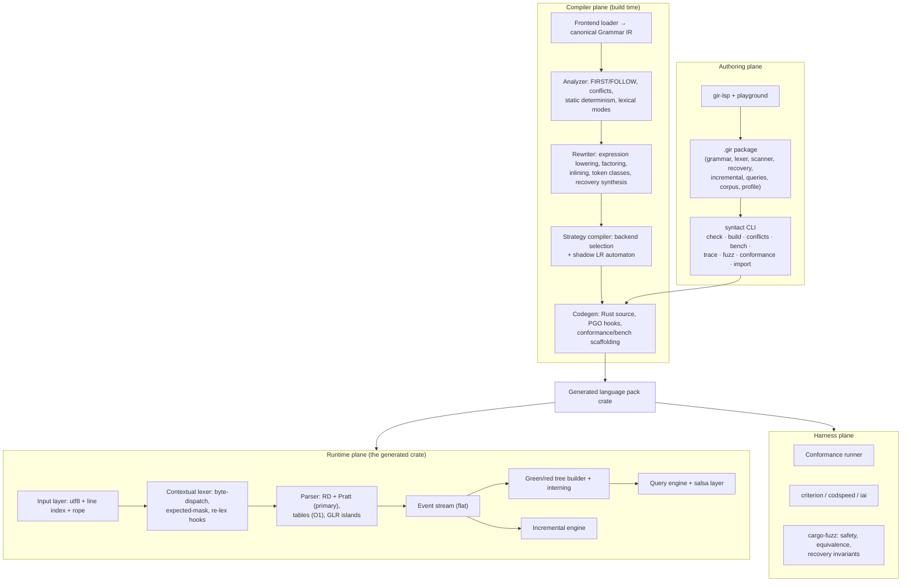
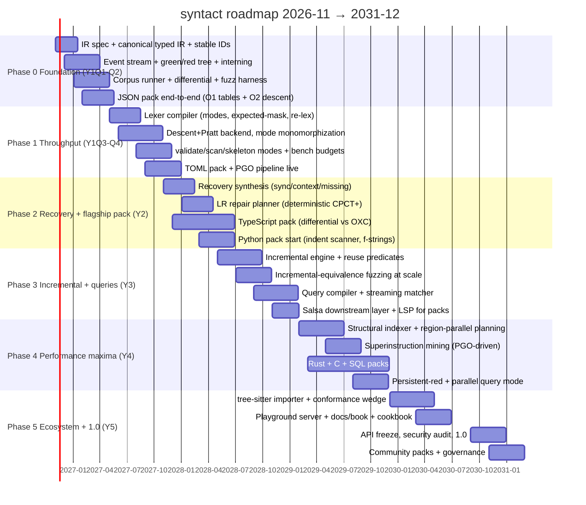

# syntact — Architecture & Multi-Year Roadmap (v2.0)

**Document:** architecture and roadmap for a grammar-IR-driven parser compiler, rebuilt from primary-source research.
**Date:** 2026-11-02. **Status:** supersedes `arch.md` v1 and `tech-stack.md` v1 (both preserved as history).
**Research method:** 9 reference codebases cloned and read at source level (oxc, tree-sitter, rust-analyzer, rowan, lalrpop, grmtools, biome, ruff, lezer/logos), plus web verification of papers, benchmarks, and crate claims. Every load-bearing claim below carries an evidence pointer (file path or URL). Claims that could not be verified are explicitly marked — v1 cited several sources that do not exist, and those citations have been removed and replaced with designs grounded in verified mechanisms.

---

## Table of contents

- [0. Executive summary](#0-executive-summary)
- [1. Evidence audit: what survives from v1, what gets corrected](#1-evidence-audit-what-survives-from-v1-what-gets-corrected)
- [2. Research foundations: the steal-list, with evidence](#2-research-foundations-the-steal-list-with-evidence)
- [3. Product definition, goals, and scope discipline](#3-product-definition-goals-and-scope-discipline)
- [4. System architecture](#4-system-architecture)
- [5. Grammar IR and package format](#5-grammar-ir-and-package-format)
- [6. Compiler pipeline](#6-compiler-pipeline)
- [7. Runtime and generated code](#7-runtime-and-generated-code)
- [8. Public API sketch](#8-public-api-sketch)
- [9. Developer experience](#9-developer-experience)
- [10. Performance engineering method](#10-performance-engineering-method)
- [11. Correctness and conformance](#11-correctness-and-conformance)
- [12. Multi-year roadmap](#12-multi-year-roadmap)
- [13. Risk register and pivot criteria](#13-risk-register-and-pivot-criteria)
- [14. Architecture decision records](#14-architecture-decision-records)
- [15. Annotated bibliography](#15-annotated-bibliography)
- [16. Appendices](#16-appendices)

---

# 0. Executive summary

**What we are building.** `syntact` is a staged parser compiler: a grammar package (`.gir`) goes in; a production-grade Rust parser crate comes out. The generated parser is not a table dump — it is code that reads like the best hand-written parsers in the Rust ecosystem (OXC, ruff, rust-analyzer), because those parsers are the performance ceiling and we generate code in their image. The user never chooses a parsing algorithm; the compiler classifies determinism at build time, selects backends per grammar region, and compiles in error recovery, incremental reuse machinery, queries, and multiple build modes.

**The five architectural bets (each defended by primary-source evidence in §2 and formalized as ADRs in §14):**

1. **Generated recursive descent + Pratt as the primary backend, with an LR "shadow automaton" compiled alongside it.** Every fastest production parser in Rust is hand-written recursive descent (OXC, ruff, biome, rustc, rust-analyzer). Table-driven LR remains a secondary tier (O1) and — crucially — the LR automaton is retained even for the descent backend as a *shadow*: it supplies parse states (for incremental reuse), FIRST/expected sets (for parser-directed lexing and diagnostics), and a repair planner (for CPCT+-class error recovery) without forcing the hot path through table dispatch. This resolves the v1 tension between "recursive ascent is fastest" and "generated parsers need recovery": lalrpop's recursive-ascent mode *cannot do error recovery at all* (it panics on error tokens — `lalrpop/src/lr1/codegen/ascent.rs:344-346`), while its table mode needs a stack-simulation (`__accepts`) just to make recovery sound.
2. **Reuse machinery is a codegen contract, not a runtime afterthought.** Verified from tree-sitter source: incremental reuse works because every subtree stores its `parse_state` and external-scanner state (`lib/src/subtree.h:110-153`), and reuse is rejected on a precise predicate list (`lib/src/parser.c:753-836`). We make those fields first-class outputs of the parser IR and codegen from day one (ADR-005), plus lezer's two safety inventions — context hashes on nodes and recorded lookahead margins (`lezer` `src/parse.ts:87-89`, `stack.ts:419-430`) — which tree-sitter lacks for context-sensitive languages.
3. **The green/red tree with structural sharing is the memory and incrementality substrate** (rowan/cstree lineage), with the parser emitting a flat 8-byte event stream (rust-analyzer lineage) instead of building trees directly. Tree-sitter's children-before-header allocation trick and small-leaf inlining carry over. SoA is a storage refinement of the green layer, not a replacement for the red/green semantics — v1 had this relationship inverted.
4. **Compiled, layered error recovery with a determinism guarantee.** v1 planned to use grmtools' CPCT+ as-is; the actual implementation (`lrpar/src/lib/cpctplus.rs`, 845 lines — not "<500 LoC") is explicitly non-deterministic and wall-clock-bounded, which is disqualifying for editors. We adopt its algorithm shape (uniform-cost search over cactus parse-stack prefixes; Corchuelo et al. via Diekmann & Tratt's "Don't Panic!", ECOOP 2020) but with canonical repair ordering and a work budget instead of a time budget, layered under grammar-derived context sync sets (ruff's `RecoveryContext` pattern) and biome's bogus-node/missing-marker conventions.
5. **Performance is an operating model, not a phase.** Allocation-count snapshots gate CI (OXC's `tasks/track_memory_allocations`), criterion/codspeed benchmarks run per commit, PGO is wired from the first generated parser, and every optimization lands only with a measured win and a conformance gate. Calibrated expectations: superinstructions buy ~5–15% (Ertl & Paysan ECOOP 2024; 8.45% measured in recent superinstruction-synthesis work), PGO ~10–20%, BOLT ~5% on top — the big wins come from architecture (no allocation, no tables on hot paths, parser-directed lexing, mode specialization), not from late-stage tricks.

**Roadmap in one line.** Year 1: pipeline end-to-end (lexer compiler → descent backend → events → green/red trees → validate/scan modes) with JSON + TOML packs beating tree-sitter on throughput modes. Year 2: expressions, recovery, full CST modes, TypeScript pack validated differentially against OXC, Python pack. Year 3: incremental engine + queries + editor integration. Year 4: structural indexing, parallel skeleton parsing, PGO-maxed flagship packs (Rust, C, SQL). Year 5: tree-sitter import wedge, ecosystem, 1.0. Six phases, each with a hard, measurable exit gate (§12).

**Why this is 10× better than the v1 drafts.** v1 was a good idea inventory with three fatal weaknesses: (a) it cited systems that do not exist (`gotreesitter`, `adze_glr_core`, `plotnik`) and numbers that cannot be verified; (b) its technique list was never forced through the "how does this survive contact with a real grammar" test — e.g., it never reconciled recursive-ascent codegen with error recovery, and it claimed runtime-adaptive fallback (ANTLR-style) while also wanting deterministic codegen; (c) it had no operating model — no budgets, no conformance gates tied to evidence, no correctness harness design, no staffing model. v2 keeps v1's skeleton (Grammar IR → strategy compiler → generated Rust pack → runtime kernel; KDL surface; mode specialization; Pratt lowering; playground DX) and replaces its speculative tissue with verified mechanisms, concrete data layouts, a shadow-automaton design that unifies recovery + reuse + diagnostics, measurable gates, and an evidence audit (§1).

---

# 1. Evidence audit: what survives from v1, what gets corrected

## 1.1 Method

Four parallel source-code deep dives were run over shallow clones (2026-11-02): OXC @ 0.156.0 (`563cf449`), tree-sitter v0.28.0, rust-analyzer (salsa 0.28.5), rowan 0.18.0-alpha.2, lalrpop, grmtools, biome, ruff (sparse), lezer (`lr`/`generator`/`common`). Web checks verified: cstree feature claims, TypeScript native-port numbers, OXC conformance numbers, the CPCT+ paper's existence and venue, Pika parsing, simdxml, simd-lex, and VM superinstruction literature.

## 1.2 Verdict table

| # | v1 claim | Verdict | Evidence |
|---|---|---|---|
| 1 | "Event stream first" enables all modes | **Confirmed** (strengthened) | rust-analyzer `crates/parser/src/event.rs:12-79` — events kept to 8 bytes; biome and ruff share the same lineage |
| 2 | Pre-goto state must be stored on interior nodes for non-leaf reuse | **Confirmed in substance** — but the cited source ("gotreesitter") does not exist | tree-sitter `lib/src/subtree.h:110-153`: `SubtreeHeapData` stores `parse_state: TSStateId` and `first_leaf.parse_state` on every node; reuse matches against it (`parser.c:470-503`) |
| 3 | CPCT+ is <500 LoC, usable as-is | **Corrected** | grmtools `lrpar/src/lib/cpctplus.rs` is **845 lines**; explicitly **non-deterministic** ("amongst `ParseRepair`s of the same rank, the ordering is non-deterministic", cpctplus.rs:542-546) and **wall-clock bounded** (`finish_by: Instant`) — both unacceptable for editors; we vendor the idea, not the code (§7.5) |
| 4 | LALRPOP recursive ascent = default codegen; "produces better error messages" | **Corrected** | Recursive ascent is one function per state with stack-suffix params (`lalrpop/src/lr1/codegen/ascent.rs`, 1010 lines) but **does not support error recovery** (`panic!` at ascent.rs:344-346); table mode needs `__accepts()` stack simulation for sound recovery (parse_table.rs:1353-1368) |
| 5 | ANTLR-style "deterministic-first, runtime fallback" | **Sharpened to compile-time** | ANTLR's adaptive DFA cache has cold-start cost; tree-sitter instead *knows* per-state lex modes and validity at build time (`crates/generate/src/render.rs` emits `ts_lex_modes[]`, `ts_external_scanner_states[][]`); we classify determinism statically (§6) |
| 6 | SoA lazy trees are the tree design | **Inverted** | Structural sharing (green interning + dedup) is the primary mechanism; laziness is secondary. rowan's `NodeCache` dedup saved **17% of green-node memory** on rustc's own parser.rs measurement (`rowan/src/green/node_cache.rs:101-107`); cstree adds persistent red nodes + interned text (verified via crates.io README) |
| 7 | `adze_glr_core` provides persistent-GSS for GLR islands | **Unverifiable — removed** | No crate, repo, or publication found. GLR islands designed instead on a custom arena GSS with shared tails (§7.4), referencing Bison GLR / RNGLR / Elkhound literature |
| 8 | `plotnik` query language + tree-sitter streaming matcher as query substrate | **Unverifiable — removed** | No crate found. Query engine designed as a custom pattern-compiler modeled on tree-sitter `lib/src/query.c` (4,889-line reference: QueryStep array, pattern map, capture pools) |
| 9 | `simdlex` proves simdjson-style stage-1 indexing for arbitrary grammars | **Corrected citation** | The real artifact is `alexbolfa/simd-lex` (C, SIMD sublexers, "13× GCC" per repo description) and **simdxml** (cigrainger.com/blog/simdxml, Mar 2026): two-pass SIMD structural indexing transfers beyond JSON — carry-less-multiply quote masking, flat SoA index at ~16 B/tag vs pugixml ~35 B/DOM node |
| 10 | `logos` 424 MB/s; LALRPOP 496–509 MB/s; `phf` 40–60% keyword speedup; memchr "6.3×"; simdutf8 "23×" | **Downgraded to "vendor-reported, re-benchmark locally"** | These specific figures could not be independently verified; they remain plausible vendor README claims. §10 makes per-grammar benchmarking of keyword-dispatch strategy and lexer backend a *decision-by-measurement*, not a citation |
| 11 | tree-sitter lexer can take an expected-token mask | **Opportunity confirmed, mechanism refined** | tree-sitter's lexer gets only a per-state lex mode + an external-token validity whitelist (`lib/src/parser.c:536-560`, `language.c:182-196`); token validity is checked *after* lexing against the parse table. A kind-bitset expected mask pushed into the lexer is a genuine improvement over tree-sitter (§7.3) |
| 12 | rust-analyzer `TokenSet` = u128 | **Corrected** | `crates/parser/src/token_set.rs`: `struct TokenSet([u64; 3])` — 192 bits, const bit-ops on SyntaxKind discriminants. Biome: `TokenSet([u128; 3])` |
| 13 | rust-analyzer does incremental reparsing in production | **Nuanced** | `crates/syntax/src/parsing/reparsing.rs` exists (single-token replace + nearest-braced-block reparse) but the production salsa query is a **full reparse with LRU** (`base-db/src/editioned_file_id.rs:20-38`, `lru = 128`); the block fast path is used for speculative parses. Lesson: green-tree sharing + full reparse is often enough; fast paths are accelerators, not the foundation (§7.7) |
| 14 | OXC conformance claims | **Confirmed** | `tasks/coverage/snapshots/` at clone: parser test262 **47474/47474 (100.00%)**, TypeScript AST **9859/9868 (99.91%)**; published docs state 100% Test262 / 99.62% Babel (oxc.rs/docs) |
| 15 | TypeScript-native-port as motivation for native parsers | **Confirmed** | "A 10x Faster TypeScript" (Microsoft DevBlogs, Mar 2025): 77.8s → 7.5s build on large project |
| 16 | Superinstructions: "45% dispatch reduction / 18% speedup" | **Calibrated** | Unverifiable as stated. Verified adjacent results: VM IP-update elimination gives >2× on loop-dominated benchmarks on recent cores, 1.1–1.3× typical (Ertl & Paysan, ECOOP 2024, LIPIcs 313); data-driven superinstruction synthesis: **8.45%** end-to-end interpreter speedup (ACM 10.1145/3689490.3690403). Gate for us: ≥10% measured, PGO-selected only |
| 17 | Pika parsing as recovery-oriented fallback | **Studied, not chosen** | arXiv:2005.06444 confirmed (reverse packrat DP; left recursion + error recovery). Trade-off space (memoization-heavy, PEG) does not fit CST/lossless/editor goals; keep as literature, not a backend |
| 18 | OXC alloc: bumpalo-based arena | **Confirmed and deepened** | OXC **vendors** bumpalo into `crates/oxc_allocator/src/arena/` to tune it; `alloc<T>` has a `const` assert statically rejecting `Drop` types; `AllocatorPool` for thread reuse; allocation-count snapshots gate CI (`tasks/track_memory_allocations/allocs_parser.yaml`) |

## 1.3 Verified numbers worth keeping (with sources)

| Fact | Value | Source |
|---|---|---|
| OXC parser test262 conformance | 100.00% (47,474/47,474) | `tasks/coverage/snapshots/parser_test262.snap` at clone; oxc.rs docs |
| tree-sitter error-cost constants | RECOVERY=500, MISSING_TREE=110, SKIPPED_TREE=100, SKIPPED_LINE=30, SKIPPED_CHAR=1 | `lib/src/error_costs.h:4-9` |
| tree-sitter version bounds | MAX_VERSION_COUNT 6, MAX_COST_DIFFERENCE 18×100, stack link count 8 | `lib/src/parser.c:77-81`, `stack.c` |
| tree-sitter external scanner state | 24-byte inline, 1024-byte max, serialized per external token, memcmp equality | `subtree.h:21-37`, `parser.h:14` |
| tree-sitter language ABI | versions 13–15 in the wild; `TREE_SITTER_LANGUAGE_VERSION 15` | `lib/include/tree_sitter/api.h:29` |
| grmtools CPCT+ parameters | PARSE_AT_LEAST=3, TRY_PARSE_AT_MOST=250, Dijkstra over cactus stacks, 845 LoC | `lrpar/src/lib/cpctplus.rs:25-51,158-173` |
| lezer safety margins | 128-char fragment gap, 25-char lookahead margin, MaxStackCount 12, insert cost 200 / delete 190 / Rec.Distance 5 | `common/src/parse.ts:25-101`, `lr/src/stack.ts:5-10`, `lr/src/parse.ts` |
| rust-analyzer parser guard | PARSER_STEP_LIMIT 150k (debug) / 15M (release) | `crates/parser/src/parser.rs` |
| rowan green dedup saving | 17% green-node memory on rustc parser.rs | `rowan/src/green/node_cache.rs:101-107` |
| SIMD structural indexing (XML) | ~16 B/tag SoA index vs ~35 B/DOM node (pugixml) | cigrainger.com/blog/simdxml (2026) |
| VM superinstruction synthesis | 8.45% interpreter speedup (Ethereum case study) | ACM 10.1145/3689490.3690403 |

---

# 2. Research foundations: the steal-list, with evidence

This section is the distilled design dossier. Each system gets: what to steal (mechanisms worth copying), what to avoid, and where the evidence lives. These mechanisms reappear as numbered features in §6–§7.

## 2.1 OXC — the hand-written-descent ceiling (and how to generate toward it)

**Steal:**

- **Vendored bumpalo arena with statically rejected drop types.** `crates/oxc_allocator/src/allocator.rs`: `pub fn alloc<T>(&self, val: T) -> &mut T` with `const { assert!(!std::mem::needs_drop::<T>()) }`. Arena `Vec`/`Box`/`String`/`HashMap` ports with `'a` lifetimes (`FromIn`/`IntoIn` conversion traits, `convert.rs`). `AllocatorPool` for thread-local reuse; capacity stabilizes by the third parse (reset keeps only the largest chunk). *Implication: our generated parser takes an `&'a Allocator` and every AST/CST type is parameterized by `'a`; no `Rc`/`RefCell` anywhere.*
- **Spans as `u32`+`u32` with alignment padding** (`crates/oxc_span/src/span.rs`): 8 bytes on 64-bit, 4 GiB source limit documented. Identifiers carry precomputed hashes packed with length into a single u64 (`oxc_str::Ident`).
- **Byte-handler dispatch table**: 256-entry static table of byte→handler functions, macro-generated, specialized per lexer config (`lexer/byte_handlers.rs`). Packed `Token(u128)` — start:32|end:32|kind:8|flags — one load per token (`lexer/token.rs`).
- **Checkpoint-based unbounded lookahead.** `ParserCheckpoint` = lexer cursor + token count + error count (+ cloned error vector when errors must roll back); `lookahead(pred)` = checkpoint → run → rewind (`cursor.rs`). Arrow-function disambiguation uses the classic Tristate protocol with a speculative parse under `checkpoint_with_error_recovery` (`js/arrow.rs:391`). *Implication: build rewind into the generated parser as a first-class primitive, not an ad-hoc hack; make error rollback part of the checkpoint.*
- **Two-tier errors.** Recoverable diagnostics accumulate as **deferred POD enums** (spans + `&str` args, ~232-byte `OxcDiagnostic` materialized once at parse exit); fatal errors are `#[cold]`, advance the lexer to EOF, and unwind via dummy AST nodes so the result is always structurally valid (`error_handler.rs`, `diagnostics.rs`). Every error path annotated `#[cold] #[inline(never)]`.
- **Re-lexing instead of backtracking for lexical ambiguity** (`lexer/typescript.rs`, `cursor.rs::re_lex_right_angle`): `>>` splits into `>` `>` on demand, mirroring TypeScript's scanner. Biome and ruff do the same (regex vs `/`, JSX identifiers, f-string contexts). *Implication: the lexer must expose `re_lex_current_token(context)` as a public primitive.*
- **Compile-time configuration by monomorphization**: `Parser<'a, C: ParserConfig>` where the config selects whether token collection is compiled in; a non-generic emission point prevents monomorphization blow-up across consuming crates (`src/lib.rs:485-510`). *Implication: our parse modes (validate/scan/skeleton/full) should be generic parameters, not runtime flags.*
- **Conformance as the quality engine**: coverage runs test262/Babel/TypeScript corpora into snapshot files; **allocation-count snapshots** gate CI per file (exact arena-alloc counts in `allocs_parser.yaml`); Miri runs on allocator/parser PRs; `cargo ck` + generated-code-must-be-committed (`git diff --exit-code`) CI.

**Avoid:** OXC has no incremental story and no CST (AST-only) — that is our differentiator, but it means OXC cannot teach us incremental machinery; tree-sitter and lezer do that.

## 2.2 tree-sitter — the incremental engine to match and beat

**Steal (all verified in lib/src):**

- **Per-node parse state.** `SubtreeHeapData` carries `parse_state: TSStateId`, plus `first_leaf: { symbol, parse_state }` cached on internal nodes (`subtree.h:110-153`). This is what makes subtree reuse resumable. Leaves inline into the `Subtree` handle when small (`SubtreeInlineData`, symbol u8, state u16; `subtree.c:155-164`).
- **The reuse predicate** (`parser.c:753-836`, `470-503`): reject a reusable node when `has_changes`, `is_error`, `is_missing`, `is_fragile`, external-scanner state differs (`memcmp` over serialized bytes), included ranges differ, or the first leaf's stored **lex mode** differs from the current state's mode (memcmp over `TSLexerMode`); keyword-capture tokens additionally require equal parse state. Reuse only enabled on the sole stack version (`allow_node_reuse = version_count == 1`). If a reused node later fails, the parser *breaks it down* and continues — speculative reuse with rollback.
- **External scanner state serialization** (`subtree.h:21-37`): scanner `serialize()` bytes (24 B inline, ≤1024 total) stored on the token, `deserialize()` before the next external scan; equality by memcmp; participates in reuse, token cache, and stack-merge decisions (`stack.c:722-732`). *Implication: any external/irregular scanner in our IR must have declared, serializable state — a codegen obligation, not a convention.*
- **The error cost model** (`error_costs.h`, `parser.c:1291-1478`): two recovery strategies — (1) find an earlier stack state that accepts the lookahead, wrapping skipped subtrees in an ERROR node; (2) wrap the lookahead itself in an ERROR node and push. Costs from the constants table (§1.3); version comparison scales the decisive margin by nodes-parsed-since-error (`(diff) * (1 + other.node_count) > MAX_COST_DIFFERENCE`); versions pause/halt/merge; missing-token insertion handled at `handle_error`.
- **Changed ranges** (`get_changed_ranges.c`): parallel old/new tree-cursor walk with `Matches/MayDiffer/Differs` classification (size, state, error-cost, external-state, has-changes bits) → coalesced byte ranges.
- **Pools and caps**: SubtreePool freelist (cap 32), stack node pool (cap 50), 1-entry token cache, allocator hook (`ts_set_allocator`), cancellation/progress callbacks, resumable parses.
- **Generated parser shape** (`crates/generate/src/render.rs`): `uint16_t` states/symbols/fields; big table for large states + grouped "small tables"; per-state lex modes; per-external-lex-state validity matrix; generated lex fn = one big `switch(state)`; `reusable` flag bit in action entries.

**Improve (our differentiators):** expected-token kind-bitset pushed into the lexer (tree-sitter checks validity only after lexing); deterministic recovery ordering (tree-sitter sorts reduce actions deterministically as of 0.25+ — we go further, §7.5); Rust-native safety with arenas instead of global pools; context hashes and lookahead margins (from lezer) for context-sensitive reuse; green-tree interning (tree-sitter dedups nothing — identical subtrees are re-allocated).

**Avoid:** tree-sitter's global mutable `TSParser` with `ts_parser_reset()` hazards; the C ABI as our primary API (we generate a shim later, §12).

## 2.3 rust-analyzer + rowan — events, token sets, green/red, salsa

**Steal:**

- **The 8-byte event model** (`crates/parser/src/event.rs`): `Start { kind, forward_parent: Option<NonZeroU32> }`, `Finish`, `Token { kind, n_raw_tokens: u8 }`, `Error { err: u32 }` (message lives in a side table). `forward_parent` implements left-recursion wrapping ("precede") without re-parsing. `event::process` flattens into `Output`, a bitpacked `Vec<u32>` DFS stream (`|16b kind|8b n_tokens|4b tag|4b leftover|`). *Implication: this exact shape becomes our compiler-internal event protocol; the tree sink is a consumer, which is what enables validate/scan/skeleton modes to exist at all.*
- **`Input` as struct-of-arrays** (`input.rs`): `kind: Vec<SyntaxKind>`, `joint: Vec<u64>` (gluing bits for `>>`/`::` splitting), `contextual_kind` — the parser never sees text.
- **192-bit `TokenSet` const bit-ops** for expected/recovery sets; step-limit guard against non-progress loops (150k debug / 15M release).
- **Recovery idioms** (`parser.rs:270-305`, `grammar.rs`): `expect`/`err_recover(TokenSet)`/`err_and_bump`; `error_block` wraps `{...}` in an ERROR node; `Marker` with `DropBomb` forcing complete/abandon.
- **rowan green layout** (`green/node.rs`): thin-Arc header `{kind, text_len}` + inline slice of tagged child pointers, **each child pre-carrying its relative offset** (enables binary-search `child_at_range`); text is never stored in nodes (tokens store it); red layer = refcounted zipper (`NodeData { parent: NonNull, index, green, offset }`) created on traversal, freed at rc 0; `Send+Sync` greens; `SyntaxNodePtr` for stable across-parse references resolved by offset walk.
- **NodeCache dedup** with manual pre-hashing; nodes with >3 children skip interning (cost/benefit measured); one cache shared across parses.
- **salsa 0.28 pattern** (`base-db`): `#[salsa::tracked(lru=128)] parse(query)`, inputs with `Durability` tiers, interned structs, `returns(as_deref)` firewalls. *Implication: our downstream query layer (symbols, folds, diagnostics) is a salsa DB over the green tree, never over the red layer.*
- **Incremental reparse fast paths** (`syntax/src/parsing/reparsing.rs`): single-token re-lex-and-replace, nearest balanced-brace block reparse — cheap heuristics *before* the general engine.

## 2.4 biome — trivia discipline, speculative parsing, recovery ergonomics

**Steal:**

- **Trivia never enters the event stream**: the token source accumulates a flat `Trivia` list (kind, range, trailing flag) and the tree sink attaches it at token emission, splitting leading/trailing at newline boundaries (`crates/biome_parser/src/tree_sink.rs`). Ruff keeps a parallel full token vector for the same purpose.
- **Three-part checkpoints** (`biome_js_parser/src/parser.rs:133-151`): context checkpoint (event pos + error pos), lexer checkpoint (POD position/kind/flags), state checkpoint — rewinds truncate events and diagnostics; **speculative parsing disables recovery** so backtracking cannot "succeed" by silently skipping tokens.
- **`rewrite_events`**: on failed speculation, split off the speculative event suffix and re-run it through a rewriting consumer that re-shapes it into the alternative grammar's tree (arrow params → parenthesized expr) — errors are preserved, not rolled back (`crates/biome_js_parser/src/rewrite.rs:53-72`).
- **List traits with progress assertion**: `ParseNodeList`/`ParseSeparatedList` + `ParserProgress` panics on zero-progress loops; missing separators become *missing markers* in the CST; `ParseRecoveryTokenSet` bumps junk into `Bogus*` nodes until a recovery-set token, EOF, or line break.
- **Whole-green-node interning** (`biome_rowan/src/green/node_cache.rs`): biome interns entire nodes, not just tokens (Roslyn's optimization), with pre-computed hashes and a two-generation GC.
- **Lex contexts + re-lex** (`JsLexContext`: TemplateElement/JsxChild/JsxAttributeValue; `JsReLexContext`: Regex/BinaryOperator/TypeArgumentLessThan/JsxIdentifier): the single token stream serves multiple grammar interpretations via demand re-lexing.

## 2.5 ruff — recovery contexts as first-class grammar data

**Steal:**

- **`RecoveryContext: u32` bitflags** — 32 flags, one per syntactic list context (MODULE_STATEMENTS, BLOCK_STATEMENTS, EXCEPT, TYPE_PARAMS, …), each carrying `is_list_element`, `is_list_terminator`, `allow_trailing_comma`, `create_error`. The parser pushes/pops context words around lists; on a non-element token it consults the enclosing context stack to decide *re-lex-then-break* vs *skip-and-report*. *Implication: this is the runtime half of our compiled recovery synthesis — the IR generates the context table, the generated parser uses it mechanically (§7.5).*
- **Interpolated-string context stack** (PEP 701 f-strings, `lexer/interpolated_string.rs`): `InterpolatedStringContext { flags, nesting, format_spec_depth }` stacked; interpolation bodies are lexed/parsed by the ordinary expression parser. This is the cleanest existing design for nested lexical modes with full nesting.
- **Zero-copy hot path**: borrowed `&'src str` slices for string values, `Name::new_inline` small-string interning, pre-sized token vector ("three quarters of Python files have ≥1 token per 8 bytes" → allocate len×3/8 bucketed), `ScratchBuffer` pools with snapshots, `stacker::maybe_grow` for deep recursion safety.
- **Soft keywords**: lexer emits keyword kinds; the parser reinterprets contextually (`bump_soft_keyword_as_identifier`).
- **Checkpoint with lexer state snapshot** (indentations, interpolated strings, errors) for parenthesized-tuple vs expression speculation.

## 2.6 lalrpop — LR construction done right (as our shadow compiler)

**Steal:**

- **Normalize pass ordering** (`normalize/mod.rs:76-100`): prevalidate → cond_comp → resolve → precedence → macro_expand → token_check → tyinfer → lower → inline (with an inlining *graph* to prevent cycles). Our canonicalization adopts this shape.
- **Lane-table conflict resolution** (`lr1/lane_table/` + its superb README): Pager/Chen lane tracing with union-find lane isolation and state splitting — the right algorithm for producing *minimal* LR(1) states when we build the shadow automaton.
- **Kernel worklist + FIRST fixpoint** (`lr1/build/mod.rs`, `kernel_set.rs`, `lr1/first`): `first0` repurposes EOF as an epsilon flag — small tricks that keep the analysis fast.
- **`TestAll` codegen mode**: emit *both* table-driven and recursive-ascent parsers into sibling modules and cross-test them (`lr1/codegen/test_all.rs`). *Implication: a built-in differential oracle between our own backends — we adopt this as `syntact test-all`.*
- **`__accepts()`**: simulate the automaton on a hypothetical stack to make error recovery sound in table mode — a mechanism we reuse inside the repair planner.

## 2.7 grmtools CPCT+ — the recovery algorithm shape (not the implementation)

`lrpar/src/lib/cpctplus.rs` (845 LoC): on error, uniform-cost search (Dijkstra) over *cactus* (persistent, forkable) copies of the parse-stack prefix; operators = InsertTerm / Delete / Shift ("CR Shift 3" from the Don't Panic! paper); node = `{ pstack, laidx, repairs, cf }`; success = PARSE_AT_LEAST (3) consecutive shifts or acceptance; bounded by TRY_PARSE_AT_MOST=250 and a wall-clock deadline; two-phase (search without trees, then replay chosen repair with trees). Costs per token user-tunable.

**What we keep:** cactus-stack search, insert/delete/shift operator set, cost-ranked repairs, PARSE_AT_LEAST termination. **What we fix:** (1) canonical ordering — repairs ranked by `(cost, canonical_sequence)` under a total order, so the same input always yields the same repair (v1 flagged this need; the source confirms the gap is real: "the ordering is non-deterministic", cpctplus.rs:542-546); (2) work budget (node expansions) instead of an `Instant` deadline, so results are machine-independent; (3) integration with a descent backend via the shadow automaton (§7.4–7.5) rather than requiring a table-driven parser.

## 2.8 lezer — reuse safety machinery tree-sitter lacks

**Steal:**

- **Fragments with openness** (`common/src/parse.ts:25-101`): unchanged ranges of the old tree become `TreeFragment`s with `openStart/openEnd`; edits drop a **128-char margin** around each change; fragments adjacent to edits are "open".
- **Context hashes for context-sensitive reuse** (`ContextTracker`, `@context` in grammar; context hash recorded into node buffers; **strict** mode refuses reuse when hashes differ — used by their Python indentation grammar). *This is the principled answer to "can I reuse this block in Python/Makefile/YAML?" — and it is generated from scanner-mode context, which our IR already models (§5).*
- **Recorded lookahead margins**: when a reduction's lookahead exceeded the 25-char margin, the node records a per-node `lookAhead` prop; reuse requires `end + lookAhead < fragment.to`.
- **Forced reductions + insert/delete recovery** with precomputed per-state `ForcedReduce` tables (cycle-checked), scored stacks (insert 200 / delete 190), error-node merging, and bounded cascade (`Rec.Distance = 5`).
- **Partial parsing** (`PartialParse::stopAt(pos)`): viewport parsing — parse the visible region first. This is a DX feature editors love; it falls out of our design almost for free (§8).
- **Tree-shaken node kinds at generator time** (`generator/src/grammar.ts:99-131`): unused nonterminals get no node id — keeps the kind space dense so TokenSets stay small.

## 2.9 SIMD and data-format parsing — the throughput layer

- **simdjson two-pass** (stage 1: SIMD classification into bitmasks; stage 2: sequential index walk) is architecture, not just an implementation trick. **simdxml** (2026) proved the transfer beyond JSON: carry-less-multiply prefix-XOR for quote masking across quote kinds; flat SoA structural index (~16 B/tag). **simd-lex** (alexbolfa/simd-lex) applies SIMD sublexers to C lexing at ~13× a GCC-lexed baseline.
- **memchr/memchr2/memchr3** provide runtime-dispatched AVX2/SSE4.2/NEON byte search (the primitive under our structural indexer and newline counting); **simdutf8** validates UTF-8 with the simdjson algorithm (vendor-reported up to ~23× vs `std::str::from_utf8` on x86-64 — re-verify locally, §10). Custom kernels (bracket-depth, quote classification) go through one portable abstraction (`fearless_simd` or `wide`) only if measured hot (ADR-011).
- **Implication:** the structural indexer is a *per-grammar-declared* pass (single-byte string/comment/delimiter bounds only — the simdxml precondition), feeding validation fast paths, parallel chunk parsing, lazy skeletons, and incremental invalidation scoping. It is opt-in, never load-bearing for correctness (ADR-011).

## 2.10 Academic anchors

- **Wagner & Graham (1997), tree-sitter's basis**: incremental LR via parse-state conservation; tree-sitter's implementation (§2.2) is the production reference.
- **ANTLR 4 ALL(\*)**: adaptive LL with runtime DFA cache — we take the *lesson* (deterministic fast path, fallback isolated) but move the adaptivity to compile time (§6), avoiding cold-start nondeterminism in release builds.
- **IELR / Pager / lane tables**: minimal LR(1) with fewer bogus conflicts — implemented in our shadow-automaton compiler via the lalrpop lane-table lineage.
- **Diekmann & Tratt, "Don't Panic!" (ECOOP 2020) + Corchuelo et al.**: CPCT+ — the recovery algorithm shape we adopt (§2.7). The paper's evaluation (repair of ~98% of invalid Java files, sub-second) is the quality bar; our determinism layer is the delta.
- **Pika parsing (arXiv:2005.06444)**: reverse packrat DP with strong recovery — studied; not chosen (memoization memory and PEG orientation fit poorly with lossless CSTs and editor budgets).
- **Roslyn red-green trees**: origin of the two-layer design; the 17% dedup measurement cited in rowan comes from Roslyn's practice.
- **Ertl & Paysan (ECOOP 2024) + superinstruction synthesis (ACM 2024)**: dispatch-cost reality check for superinstructions (§1.3, gate: ≥10%).
- **TypeScript 7 native port (2025)**: 10× (77.8s → 7.5s) — market evidence that native parsers/toolchains win decisively when architecture is right.
---

# 3. Product definition, goals, and scope discipline

## 3.1 The one-sentence product

> A grammar author drops a `.gir` package into `syntact`; seconds later they hold a Rust crate whose parser is competitive with the best hand-written parsers for their language, with error recovery, incremental reparsing, queries, six parse modes, a conformance report, and a playground — and every optimization decision is visible, measurable, and overridable.

## 3.2 Users and jobs-to-be-done

| Persona | Job | What they touch |
|---|---|---|
| **Grammar author** (language designer, DSL builder) | "Turn my spec into a fast, tolerant parser" | `.gir` package, `syntact check/build/conflicts`, playground |
| **Tool builder** (linter/formatter/indexer author) | "Give me a lossless, incremental CST + queries in Rust" | generated crate API, runtime kernel, salsa layer |
| **Editor/embedder** | "Reparse on every keystroke, sub-ms, highlight from queries" | incremental engine, query automata, partial parse |
| **Migration engineer** | "I have a tree-sitter/ANTLR grammar; move it" | `syntact import`, conformance diff harness |
| **Performance engineer** | "Give me the last 2×" | overrides, hot-path hooks, PGO pipeline, bench harness |

## 3.3 North-star metrics (honest, per-mode)

Performance claims in v1 ("2×–10× faster than tree-sitter") were unsorted against baselines that are themselves fast (OXC parses TS at millions of lines/second). Targets are therefore per-mode, per-baseline, and phased:

| Mode | Baseline | Year-1 target | Year-3 target |
|---|---|---|---|
| `validate` (no tree) | tree-sitter full parse | ≥3× on JSON/TOML | ≥5×; parity or better vs specialized validators |
| `scan` (tokens only) | tree-sitter parse + traversal | ≥2× | ≥3× |
| `skeleton` (partial tree) | tree-sitter full parse | ≥2× | ≥2.5× |
| `full` CST | best generated (tree-sitter) | parity ±20% | 1.2–1.5× on flagship packs |
| `full` CST | best hand-written (OXC-class) | — | within 1.5× on TS pack (stretch: parity) |
| incremental small edit | tree-sitter reparse | parity | ≥1.5×, plus byte-identical guarantee |
| queries | tree-sitter queries | parity | ≥1.5× on common highlight/symbol patterns |
| memory | tree-sitter tree | ≤1.0× bytes/node | ≤0.7× via green interning |

Non-negotiable correctness invariants outrank all of them: byte-faithful losslessness, `reparse(edit(x)) == fresh_parse(x)` (fuzz-enforced), deterministic recovery, and API stability per semver.

## 3.4 Non-goals (scope control)

- **No universal algorithm.** We do not force every grammar through one parser model; we also do not promise to make PEG/GLR/Earley fast everywhere.
- **No hand-written per-language parsers** (except thin override hooks and, eventually, escape hatches).
- **No semantic analysis.** Scopes, types, name binding stay downstream (salsa layer is a seam, not a product).
- **No cross-language AST interchange format** in v1 beyond a debug JSON export.
- **No runtime plugin loading**; everything is AOT-compiled.
- **Not a formatter or linter**; we ship the substrate.
- **No GUI IDE**; playground + LSP for grammars only.

## 3.5 What we will not optimize for (and why)

Vendored honesty: cold-start compile time (O0 keeps it reasonable), binary size of generated parsers (hot/cold splitting mitigates), SIMD for everything (only where kernels are measured hot), and beating OXC on TypeScript in year 2 (a multi-year quest; we take parity-first).

---

# 4. System architecture

## 4.1 Three planes



## 4.2 Workspace layout

```text
syntact/
  crates/
    gir-syntax          # KDL surface parsing, span-preserving
    gir-ir              # canonical typed IR, stable IDs, interned symbols
    gir-analysis        # FIRST/FOLLOW, LL/LR classification, ambiguity
    gir-transform       # lowering passes (expr→pratt, factoring, inline…)
    lr-shadow           # LR automaton builder (lane tables), FIRST tables,
                        #   recovery planning, expected-set extraction
    lexgen              # lexer compiler (DFA codegen, keywords, modes)
    codegen-rust        # Rust source emission (descent backend, runtime glue)
    runtime-core        # events, green/red trees, interning, incremental,
                        #   queries, input layer (no_std-capable core)
    recovery            # repair planner (cactus-stack search), cost models
    harness             # conformance runner, corpus packs, differential
    bench               # criterion suites, budgets, regression gates
    cli                 # syntact binary
    lsp                 # gir language server
    playground-server   # compile-on-server, share links
  packs/
    json/ toml/ log/    # year-1 packs
    typescript/ python/ # year-2 packs
    rust/ c/ sql/       # year-4 packs
  fuzz/
  docs/                 # book, ADRs, cookbook
```

Rules: `runtime-core` never depends on grammar specifics (generated crates carry the data); generated code depends on `runtime-core` at a **pinned semver + ABI tag**; every crate is `#![no_std]`-clean except `cli`, `lsp`, `playground-server`.

## 4.3 Generated crate anatomy

```text
mylang-parser/
  src/
    lexer/mod.rs          # byte-dispatch entry, mode stack, re-lex hooks
    lexer/tables.rs       # dense tables (modes, expected masks, keywords)
    parser/mod.rs         # public API, mode monomorphization
    parser/rules/*.rs     # one module per construct — reads hand-written
    parser/expr.rs        # Pratt loop (precedence climbing)
    parser/shadow.rs      # parse-state mapping tables (LR shadow)
    parser/recovery.rs    # sync sets, context table, repair glue
    events.rs             # event emission glue
    tree.rs               # green-node builders, node-kind metadata
    queries.rs            # compiled query step tables (if queries/)
    lib.rs                # Language trait impl, version/ABI tags
  benches/ corpus/ fuzz/  # generated scaffolding
```

The **readability contract** (ADR-013): generated modules must be stable under regeneration (diff-friendly ordering), named after grammar constructs, and debuggable in a normal debugger — reviewed manually for the flagship packs.

---

# 5. Grammar IR and package format

## 5.1 Design principles

1. **One canonical typed IR.** KDL is the *surface*; `gir-ir` is typed Rust (`Grammar`, `Rule`, `Production`, `TokenDef`, …) with stable interned IDs (`RuleId(u32)`, `TokenId(u16)`, `StateId(u16)` — widths chosen to match tree-sitter's proven u16 tables). All passes consume/produce typed IR; nothing re-parses strings.
2. **Stable IDs everywhere.** IDs survive incremental grammar edits (hash-consed on (name, content)); this makes grammar-file diagnostics and codegen diffs stable.
3. **Hints, not requirements.** The IR accepts annotations (`@pratt`, `@sync`, `@reuse`, `@fragile`, `@cold`) but the compiler infers everything by default; `syntact check` reports where inference disagreed with hints (this catches authoring mistakes — v1's "conflict report" idea, made concrete in §9.2).
4. **Importers are first-class frontends.** tree-sitter `grammar.js`, ANTLR, and lalrpop grammars compile *into* the canonical IR with a provenance log; every transformation is recorded so conformance diffs can point at the responsible rule.
5. **Versioned + feature-gated.** The IR has a schema version; packages declare `ir_min`/`ir_max`; unknown annotations are errors, unknown sections are warnings (forward-compat).

## 5.2 Package layout (v2)

```text
mylang.gir/
  manifest.kdl         # metadata, capabilities, opt-level, dialects
  grammar.kdl          # syntax rules + node/field annotations
  tokens.kdl           # tokens, literals, keywords, trivia policy
  scanner.kdl          # lexical modes, indentation, templates, externals
  recovery.kdl         # sync sets, repair costs, missing-token policy
  incremental.kdl      # reuse boundaries, context keys, margins
  indexing.kdl         # structural-index scope (opt-in, ADR-011)
  queries/*.scm-q      # query patterns (validated at build time)
  corpus/              # conformance cases (+ expectations)
  profile/             # representative files for PGO & hot-path mining
  overrides/*.rs       # hand-tuned escape hatches (reviewed, signed)
```

## 5.3 Illustrative grammar (JSON, complete)

```kdl
language "json" { version="1.0.0"  extensions=["json"]  unicode=true }

tokens {
    number   = re<[0-9-]+(\.[0-9]+)?([eE][+-]?[0-9]+)?>  @node
    string   = re<"[^"\\]*(\\.[^"\\]*)*">                @node  @index_bound("\"")
    lbrace="{"  rbrace="}"  lbrack="["  rbrack="]"  colon=":"  comma=","
    kw_true="true"  kw_false="false"  kw_null="null"
    trivia_ws = re<[ \t\r\n]+>  @trivia
}

grammar {
    value      = | object | array | string | number | true | false | null
    object     = "{" pair_list? "}"                    @node  @reuse
    pair_list  = separated(pair, ",", allow_trailing)  @list
    pair       = string ":" value                      @node  @field(name: string) @field(value: value)
    array      = "[" value_list? "]"                   @node  @reuse
    value_list = separated(value, ",", allow_trailing) @list
}

recovery {
    value      { sync=[",", "]", "}", <eof>]           insert=[true, false, null] }
    pair_list  { sync=[","]                            repair=balanced }
    object     { sync=["}", <eof>]                     wrap_error }
}

incremental {
    reuse      = [object, array]          // value is cheap; objects/arrays are worth reusing
    context_key = []                      // json is context-free → no context hashes
    margin      = 25                      // lezer-style lookahead margin
}

indexing {
    bounds = [string, trivia_ws]          // single-byte-bounded regions (§2.9 precondition)
    enable = true
}
```

For a context-sensitive language the same sections gain teeth. TypeScript-flavored example:

```kdl
scanner {
    mode_stack = [normal, template, jsx_child, jsx_attribute]
    re_lex     = [r_angle_split, regex_vs_div]        // oxc/biome/ruff lesson (§2.1, §2.4)
    template {
        interpolation = "${" "}"   nesting=context
        serialize     = required              // external-state serialization (§2.2)
    }
    indentation { enabled=false }        // python pack would flip this
}

incremental {
    reuse       = [statement, declaration, class_member, function_body]
    context_key = [lex_mode, indentation_stack_digest]   // lezer context hashes (§2.8)
    fragile     = [arrow_function]                        // speculative-parse boundary
}
```

## 5.4 What the IR stores for optimization (the v1 hint list, formalized)

| IR datum | Consumer pass | Default inference if absent |
|---|---|---|
| `@pratt { lbp, rbp, assoc }` on binary ops | expression lowering | detect expression regions by recursion shape |
| `@sync [..]`, `@wrap_error`, `insert=[..]` | recovery synthesis | FOLLOW-based sync + cost table defaults |
| `@reuse`, `@fragile`, `margin`, `context_key` | incremental compiler | statement/block-level reuse, 25-char margin |
| `@index_bound("c")` | structural indexer | none (indexing off) |
| `@cold` on rules | codegen (function placement, `#[cold]`) | error paths auto-cold |
| `@dialect(name)` gates | all passes | single dialect |
| token `@index`/`@node`/`@trivia` | tree builder + indexer | keywords anonymous, literals nodes |
| `@precedence` conflicts | strategy compiler | error with fix suggestion |

---

# 6. Compiler pipeline

## 6.1 Pass order (each pass: input → output, invariants, failure mode)

| # | Pass | What it does | Key algorithm (source of truth) | Fails when |
|---|---|---|---|---|
| 1 | Load & canonicalize | KDL → typed IR; resolve imports; intern symbols; assign stable IDs | lalrpop `normalize` ordering (§2.6) | duplicate rules, unknown annotations |
| 2 | Lexical analysis | token defs → DFA families per lex mode; keyword sets; trivia policy | byte-handler + DFA codegen (oxc shape); keyword strategy chosen by benchmark (ADR-010) | token ambiguity (maximal-munch violations reported with examples) |
| 3 | FIRST/FOLLOW & epsilon | fixed points; `first0` EOF-as-epsilon trick | lalrpop `lr1/first` | — |
| 4 | Static determinism classification | per-rule LL(1)? LR(1)? ambiguous-region? using the shadow automaton build | kernel construction + lane tables (§2.6) | genuine ambiguity → *ambiguity report with two derivations* (§9.2), build continues with GLR island iff `@allow_ambiguous` |
| 5 | Expression lowering | detect expression regions → Pratt table (lbp/rbp/assoc); erase from CFG | v1 idea kept; validated against test262-style corpora | unreproducible precedence conflicts |
| 6 | Left factoring & inlining | factor common prefixes; inline single-use/cold rules; inlining graph prevents cycles | lalrpop `normalize/inline` | inlining budget exceeded (code-size guard) |
| 7 | Token-class inference | group tokens never distinguished in any parser state | tree-sitter token-map idea (`ts_symbol_map`), extended | — |
| 8 | Shadow automaton | build minimal LR(1) (lane tables); extract per-state: expected-token mask, lex mode, reduce info; mark reuse states | §7.4 | automaton too large → report, suggest factoring |
| 9 | Reuse-boundary inference | choose node kinds worth `parse_state`-stamping; context keys; margins | §7.7 | — |
| 10 | Recovery synthesis | context table (ruff-shaped), sync sets, insert sets, cost calibration from corpus/profile | §7.5 | — |
| 11 | Mode planning | decide what each mode compiles away; dead-code plan | §7.10 | capability conflicts |
| 12 | Codegen | emit Rust (descent + Pratt + shadow tables + recovery + glue); emit bench/fuzz/conformance scaffolding | §7 | readability review gate |
| 13 | PGO wiring | instrument profile corpus, emit `cargo pgo` scripts, merge profiles | continuous from day 1 (ADR-014) | — |

Passes 4, 8, 10 are the load-bearing additions vs v1 — everything else is the v1 pipeline with owners, algorithms, and failure modes attached.

## 6.2 Static determinism analysis (the compile-time ALL(*) replacement)

For each rule (and each call site of it), the analyzer answers: *can this region be parsed by the generated descent code with (a) one-token lookahead, (b) bounded checkpoint lookahead, or (c) not without ambiguity?* Method: build the LR(1) shadow automaton; a rule region is **deterministic** iff the automaton restricted to that region has no conflicts after lane-table resolution; **checkpoint-deterministic** iff conflicts vanish with k-token lookahead simulated via the kernel graph (bounded k, reported); otherwise **ambiguous** — the region becomes a GLR island candidate (requires `@allow_ambiguous` or gets an error with two counter-example derivations).

Output artifacts (all first-class CLI reports):

```text
determinism score: 98.7% of productions deterministic (LL(1): 91.2%, k>1: 7.5%)
islands:            2 regions (ternary ? : — checkpoint; C-style cast — GLR)
conflict report:    1 shift/reduce in `old_ternary`, suggested fix: @pratt(right, 4)
ambiguity heatmap:  per-rule conflict density over corpus profile
```

This is the honest version of v1's "deterministic-first with fallback": the fallback decision happens at build time, per region, and every fallback is visible in a report instead of hidden in a runtime cache.
---

# 7. Runtime and generated code

## 7.1 Input layer

```rust
pub struct Source<'a> { bytes: &'a [u8], /* validated */ line_index: LineIndex }
```

- `simdutf8::basic::from_utf8` for validation (with a `compat` fallback for error positions); `memchr` for newline counting into a lazily-built line index (O(log n) `offset→(line, col)`); `ropey::Rope` accepted as an alternative input for editor integrations — the incremental engine consumes rope deltas as edit descriptors (§7.7). u32 offsets everywhere (4 GiB documented limit, OXC precedent). A structural index (§7.9), when enabled, hangs off `Source` and is shared across modes.

## 7.2 The event stream — one protocol, six consumers

The parser never builds trees. It emits rust-analyzer-shaped events, 8 bytes each, plus a side-table for error texts:

```rust
pub enum Event {                       // 8 bytes (RA-proven shape, event.rs:12-79)
    Start  { kind: NodeKind, forward_parent: Option<NonZeroU32> },
    Finish,
    Token  { kind: TokenKind, n_raw: u8 },
    Error  { diag: u32 },              // index into deferred-diagnostics side table
}
```

`process(events)` flattens `forward_parent` chains into a bitpacked `Output` u32 stream (`|16b kind|8b n_raw|4b tag|4b aux|`). Consumers:

| Consumer | Behavior |
|---|---|
| validate sink | counts/positions only — events are nearly free |
| token sink | emits tokens (highlighting) |
| skeleton builder | materializes nodes with `@reuse`/top-level kinds only |
| full CST builder | green/red tree (§7.6), trivia attach (§7.5.4) |
| streaming query matcher | runs compiled query steps during emission (§7.8) |
| incremental engine | splices `ReusedSubtree` records into the stream |

Trivia never enters the event stream (biome lesson, §2.4): the token source accumulates `(kind, range, trailing)` trivia records; the tree sink splits leading/trailing at newlines. Ruff's parallel full-token vector is offered as a mode for tools that want raw tokens.

## 7.3 Lexer runtime

Generated shape (oxc-informed):

- **256-entry byte-dispatch table** of handler functions; packed `Token(u128)` (start:32|end:32|kind:8|flags:24); zero-copy string values as `&'a str` slices; escaped/large strings via a side table keyed by token start (oxc).
- **Mode stack** for templates/JSX/indentation (ruff's `InterpolatedStrings` design: `{ flags, nesting, format_spec_depth }` stacked; interpolation bodies parsed by the ordinary expression parser). Mode stack state is part of every checkpoint.
- **Expected-mask fast path**: the parser passes `expected: TokenSet` (a 192-bit const-bitop set, RA-style [u64;3]) before each `next_token()`. The lexer checks the mask's single-byte class dispatch first (e.g., if only `(`/`)`/`,` are expected, test those bytes directly before DFA work). tree-sitter does not do this (§1.2 #11) — it is our cleanest lexer win, and it also powers "expected one of …" diagnostics for free.
- **Re-lex hooks**: `re_lex_current_token(ReLexContext)` for `>>`→`>` `>`, regex-vs-division, JSX identifiers, TS `<` (oxc/biome/ruff pattern); the `joint` bit array (RA `Input::joint`) records token gluing so composite splitting is exact.
- **Keyword dispatch**: length-bucketed first-byte switch by default; PHF variant generated alongside; the per-grammar choice is made by the harness benchmark (ADR-010). Identifiers: ASCII fast path, unicode tables only for non-ASCII (oxc `unicode-id-start` approach).
- **External/irregular scanners** (indentation, heredocs, custom): declared in `scanner.kdl` with **serialize/deserialize obligations**; the serialized digest rides on tokens exactly like tree-sitter's `ExternalScannerState` (24 B inline / 1024 max) and participates in reuse (§7.7). Hand-written scanner overrides live in `overrides/` and are reviewed, signed, and fuzzed.

## 7.4 Parser backends and the shadow automaton

**Primary backend — generated descent + Pratt** (OXC-shaped):

```rust
// generated, reads like hand-written code (readability contract)
pub(crate) fn parse_let_statement(p: &mut Parser<'_>) {
    let m = p.start(NodeKind::LetStatement);            // marker (drop-bomb guarded)
    p.expect_kw(Kw::Let);
    parse_binding_pattern(p); p.expect(T![=]);
    parse_expression(p, Precedence::LOWEST);
    p.expect(T![;]);
    m.complete(p);
}

pub(crate) fn parse_binary_expression(p: &mut Parser<'_>, lhs: Precedence) {
    let mut lhs = parse_unary_expression(p);
    loop {
        let (op, lbp, assoc) = match p.kind_to_precedence() { Some(x) => x, None => break };
        if lbp <= lhs { break }
        p.bump(); let rhs = parse_binary_expression(p, assoc.rbp(lbp));
        lhs = p.expr_precede(lhs, op, rhs);              // forward_parent wrap
    }
}
```

- `Context` bitflags (u16) threaded through, scoped with closure helpers (oxc `context()`); statement-position enums; checkpoints = `(lexer POD state, mode-stack len, event len, error len)` with error-vector rollback variants for speculation; `lookahead(pred)` and speculative-parse with recovery disabled (biome discipline); `rewrite_events`-style re-shaping for arrow/cast ambiguity classes; `stacker::maybe_grow` recursion guard; step-limit guard (RA) for non-progress loops.
- **Parse states ride along**: every descent function entry carries a compile-time-known `StateId` into the shadow automaton; the parser stamps `state` on emitted `Start` events. This costs one u16 copy per node and buys incremental reuse + recovery planning without any table dispatch on the happy path.

**Shadow automaton** (`lr-shadow`): minimal LR(1) via lane tables over the factored grammar. Per state it precomputes:

```rust
pub struct ShadowState {
    pub expected: TokenSet,      // shiftable terminal kinds → lexer mask + diagnostics
    pub lex_mode: LexModeId,     // tree-sitter ts_lex_modes analogue
    pub reductions: u16,         // reduce-plan id (into recovery tables)
    pub sync_set: TokenSet,      // recovery synthesis output
    pub is_reuse_boundary: bool, // valid entry state for subtree reuse
}
```

**Secondary backends:** table-driven LR (O1 tier; `__accepts()`-style sound recovery — lalrpop mechanism); **GLR islands** for regions the analyzer marks ambiguous: local graph-structured stack in a `bumpalo` arena with shared tails on fork (the mechanism v1 attributed to the non-existent `adze_glr_core`; we implement ~600 LoC of GSS with fork/merge caps borrowed from tree-sitter's version bounds — MAX_VERSION_COUNT-style limits, deterministic merge on equal (state, position, cost)). Islands are selected at compile time only (ADR-007); a runtime "full GLR" never exists.

**Cross-backend oracle:** `syntact test-all` emits descent and table backends together and differential-tests them on the corpus (lalrpop `TestAll` pattern) — our own backends keep each other honest.

## 7.5 Error recovery — compiled, layered, deterministic

Layer order at an error point (each layer is generated; none is a generic panic-mode):

1. **Context sync sets** (ruff `RecoveryContext` pattern): the context table (built in pass 10) says, for the enclosing list/construct, the element/terminator sets; the parser re-lexes the offending token into enclosing contexts first (ruff's re-lex-then-break), then bumps junk into `Bogus*` nodes until a sync token / EOF / line break. Missing mandatory items become **missing markers** with empty spans at `prev_token_end` (biome/ruff).
2. **LR repair planner (CPCT+-shape)**: when the error point is inside a context flagged `repair=balanced` (expressions, argument lists), the parser consults the shadow automaton: uniform-cost search over cactus copies of the state stack with Insert/Delete/Shift operators (grmtools algorithm shape, §2.7), costs defaulted to tree-sitter's constants (500/110/100/30/1) and tunable per token in `recovery.kdl`. **Determinism:** repairs ranked by total order `(cost, canonical_repair_sequence)`; **work budget** (node expansions, default 250 like CPCT+; no wall-clock). The chosen repair is executed by the descent parser as insert-missing / delete-range / shift-and-continue, and the emitted events carry the wrapper ERROR nodes.
3. **Tree-sitter-grade fallback**: wrap lookahead in an ERROR node and continue (strategy 2 of `ts_parser__recover`), with version cost comparison when islands are active.

Diagnostics: every error event carries the expected set from the shadow state (rendered "expected one of `;`, `}`, end of input" — biome's `expected_token_any` format), a severity, and repair provenance. Deferred POD diagnostics materialize once at parse exit (oxc).

**Recovery quality metric** (CI-gated): on held-out invalid corpora (mutated real files + curated cases), report repair rate, wrong-recovery rate (measured by downstream parse continuation quality), and diagnostic precision vs the official parser's errors. Gate for phase 3: repair ≥95% of mutated files with ≤1 wrong-recovery per 10 files.

### 7.5.4 Trivia and losslessness

Trivia records attach to tokens at tree-sink time; EOF synthesizes a token carrying trailing trivia (biome). Byte-faithfulness is a fuzz invariant: `render(parse(x)) == x` for every corpus and fuzz case, including error regions.

## 7.6 Green/red trees

Green layer (immutable, position-independent, interned):

```rust
// header precedes children slice in one allocation (tree-sitter trick)
#[repr(C)]
struct GreenNodeHead {
    kind: NodeKind,            // u16
    flags: NodeFlags,          // visible/named/extra/error/missing/fragile/has_changes…
    text_len: u32,
    parse_state: StateId,      // u16 — the reuse contract (§7.4)
    ext_scanner_digest: u64,   // xxh3 of serialized scanner state (0 if none)
    first_leaf: LeafRef,       // (kind, parse_state) for the ts can_reuse_first_leaf check
    child_count: u32,
    // + inline child offset table (rel offsets) for binary-search by range
}
```

- Children allocated contiguously **before** the header in one arena allocation; small leaves inlined into the child slot (tree-sitter `SubtreeInlineData` idea) — no per-node `Arc` in our core; a `ThinArc`-based rowan-compatible view is provided for ecosystem compatibility.
- **Interning/dedup**: NodeCache-style hash-consing with pre-hashing, whole-node dedup (biome), >3-children cutoff (rowan's measured trade-off); expected saving ~17% on repetitive files (rowan's rustc measurement) and far more on generated/repetitive code.
- Error/recovery bookkeeping per node: `error_cost: u32` and `has_changes` bit maintained bottom-up — exactly the fields tree-sitter's changed-range diff and reuse checks consume.

Red layer: RA-style refcounted zipper cursor (parent/index/offset), created on traversal, freed at rc 0 — the default and cheapest view. For parallel consumers, a **persistent red mode** (cstree semantics: whole-tree arc, `Send+Sync` nodes, references instead of clones) is a cargo feature of `runtime-core`. SoA arrays are the *internal* green storage for kinds/offsets/flags per node's children; the red/green semantics are never sacrificed to SoA (correction of v1, §1.2 #6).

Memory budget (targets, verified against tree-sitter/rowan baselines in CI): ≤24 B/leaf green + header amortization; ≤1.0× tree-sitter bytes/node in year 1, ≤0.7× with interning by year 3.

## 7.7 Incremental engine

Pipeline for `reparse(old_tree, edits: &[Edit], new_source)`:

1. **Edit normalization**: rope deltas → sorted `Edit { start, deleted_len, inserted_len }`; mark changed ranges; propagate `has_changes` up the old tree (tree-sitter `ts_subtree_edit`).
2. **Fast paths** (RA `reparsing.rs` lessons): single-token replacement → re-lex that token, splice green token; small balanced-brace block → re-parse block with state stamp; both fall through to the general engine on mismatch.
3. **Fragment set**: old tree cut into fragments with 128-char edit margins and openness flags (lezer); fragments adjacent to edits are open.
4. **Main loop** = normal parse with the **reuse cursor** walking fragments. A subtree is reusable iff all hold (adapted from verified tree-sitter predicates §2.2): byte offset matches; `!has_changes && !is_error && !is_missing && !is_fragile`; `ext_scanner_digest` equals current; first-leaf lex mode equals current state's mode; context hash matches (lezer) when grammar declares `context_key`; included-range difference check; `end + recorded_lookahead_margin < fragment.to` (lezer). Reused subtrees are *speculative*: if the automaton rejects the continuation, the reused node is broken down and its children retried (tree-sitter `breakdown_top_of_stack` behavior).
5. **Splice**: reuse is recorded as `ReusedSubtree` in the event stream; tree builder re-links green nodes (structural sharing) instead of re-emitting.
6. **Changed ranges** for downstream invalidation: parallel old/new cursor diff with `Matches/MayDiffer/Differs` predicates (tree-sitter `get_changed_ranges.c` classification list verbatim).

**Correctness gate:** `reparse(edit(x)) == fresh_parse(x)` — tree equality including error nodes and trivia — fuzzed from day 1 of the incremental engine (10k+ edit sequences per grammar per CI run; the #1 way parser projects die is silent reuse divergence).

## 7.8 Queries

- **Build time:** every pattern in `queries/*.scm-q` is validated against the grammar (unknown node kinds/fields are build errors — DX win over tree-sitter where query typos surface at runtime). Patterns compile to a flat `QueryStep` array (tree-sitter `query.c` shape: symbol/field/capture/flags per step, pattern map, `is_dead_end`/alternative steps for `?`/`*`), plus a per-pattern **kind prefilter bitset** so whole patterns are skipped without stepping.
- **Run time:** eager matcher over the red tree for tools; **streaming matcher** consuming events during parse for validate/highlight pipelines; capture list pool with free-id stack; predicate evaluation (`eq?`, `match?`) is a consumer-side closure (tree-sitter leaves predicates to bindings too).
- **Downstream derived data** (symbols, scopes-lite, folds) lives behind a salsa DB (`runtime-core::query` + `salsa`): `#[salsa::tracked(lru=…)]` queries over green trees, durability-tiered file inputs — the RA/ruff-`ty` pattern (§2.3). Cross-file incremental invalidation comes from salsa revisions, not from our tree layer.

## 7.9 Structural indexing (opt-in, scoped)

Per `indexing.kdl`: SIMD pass over 64-byte blocks classifying single-byte bounds (quotes via memchr + carry-less-multiply prefix-XOR for quote masking, simdxml-proven), comments, bracket bytes; sequential pass builds a flat SoA index (~16 B/region target). Uses: validate fast path (skip strings/comments wholesale), parallel chunk parsing for grammars with declared independent regions, lazy skeletons, and incremental edit scoping. Never correctness-load-bearing (ADR-011).

## 7.10 Optimization tiers (what literally changes per tier)

| Tier | Grammar analysis | Backend | Recovery | Tree | Build time | Use |
|---|---|---|---|---|---|---|
| O0 | full analysis (same diagnostics everywhere) | interpreted tables | full | lazy full | seconds | dev loop, playground |
| O1 | + shadow automaton | table-driven LR | planner + sync | full | seconds | default `syntact build` |
| O2 | + reuse/recovery specialization | generated descent+Pratt (monomorphized modes) | compiled | green/red + interning | tens of seconds | release |
| O3 | + PGO profile mined from `profile/` | O2 + superinstruction fusion + region-parallel planning | tuned costs | + structural index | minutes | flagship packs |

Modes are monomorphized config generics (oxc `ParserConfig` lesson): `Parser<Validate>` compiles away tree emission entirely; `Parser<Scan>` compiles away the parser. No runtime mode checks on hot paths (ADR-009).

---

# 8. Public API sketch

```rust
// ---- parse (generated crate surface, all modes) ----
let alloc = Allocator::new();
let src = Source::new(&bytes)?;                       // validates utf8
let parsed = MyLang::parse(&alloc, &src, ParseMode::Full);
parsed.tree()            // &GreenTreeRoot — Send+Sync, cheap to clone
     .red()              // SyntaxNode cursor view (RA-style)
     .typed::<ast::Expr>() // optional typed AST layer (generated from grammar @node)
parsed.errors()          // &[Diagnostic] (deferred-POD materialized, labeled spans)
parsed.tokens()          // optional token vector mode

// ---- incremental ----
let mut engine = MyLang::incremental(parsed)?;
let delta = engine.edit(Edit::new(start, old_end, inserted_len)); // ropey-compatible
let after = engine.reparse()?;         // reuses subtrees; errors == fresh parse
after.changed_ranges()                 // &[Range<u32>] for downstream invalidation

// ---- queries ----
let q = MyLang::compile_query(queries::FUNCTION_DECL)?;  // build-time validated
for m in q.matches(parsed.tree()) { /* captures: kind-checked */ }

// ---- partial / streaming ----
let vp = MyLang::parse_partial(&alloc, &src, visible_range)?; // lezer stopAt analogue

// ---- traits (runtime-core) ----
pub trait Language: Send + Sync {
    const NAME: &'static str;
    const ABI: AbiTag;                            // codegen/runtime compat contract
    type Green: GreenTree;
    fn parse<'a>(alloc: &'a Allocator, src: &Source<'_>, mode: ParseMode)
        -> ParseResult<'a, Self::Green>;
    fn incremental(tree: Self::Green) -> IncrementalEngine<Self>;
}

pub struct ParseResult<'a, G> {
    pub green: G,
    pub errors: Vec<Diagnostic>,
    pub events: Option<Output>,                   // retained only in debug/trace builds
    pub stats: ParseStats,                        // ns, tokens, nodes, reused nodes
}
```

Properties: no `unsafe` outside `runtime-core` (generated code is safe); `GreenTree` is `Send+Sync`; `Allocator` is not `Send` (per-parse arenas, `AllocatorPool` for reuse); every API is `no_std`-compatible except rope integration and diagnostics rendering.

---

# 9. Developer experience

## 9.1 CLI (all commands support `--json` for tooling)

```bash
syntact check mylang.gir        # full analysis: conflicts, determinism score, hint disagreements
syntact build mylang.gir        # O1 default; --release = O2; --pgo = O3
syntact test-all mylang.gir     # differential: descent vs table backends on corpus
syntact bench mylang.gir        # criterion suites + budget report vs tree-sitter baseline
syntact trace mylang.gir -i x.my   # interactive parse trace (states, masks, re-lexes, repairs)
syntact conflicts mylang.gir    # ambiguity report with derivations & fix suggestions
syntact conformance mylang.gir --vs tree-sitter   # byte-level diff incl. error nodes
syntact fuzz mylang.gir         # safety + incremental-equivalence + recovery invariants
syntact import tree-sitter ./grammar.js -o mylang.gir
syntact playground mylang.gir   # local web UI
```

## 9.2 Diagnostics quality (the adoption battleground)

Bad (what everyone ships): `error: conflict in expression`.
Good (what `syntact conflicts` prints):

```text
shift/reduce conflict in rule `old_ternary` (grammar.kdl:42)

  input:      a ? b : c ? d : e
  interp #1:  a ? b : (c ? d : e)
  interp #2:  (a ? b : c) ? d : e

suggestion: right-associativity is standard here —
  @pratt { assoc = right }        (most languages)
or wrap the consequent:           (if #2 is intended)
  consequent = "(" expression ")"
```

Runtime parse diagnostics carry spans, expected sets, repair provenance, and (in trace mode) the exact state/mask that accepted the repair. Diagnostics render via `runtime-core::diagnose` (vendored minimal renderer, miette-style labeled snippets, OXC lesson: keep the dependency light and in-tree).

## 9.3 Playground

Local-first web UI (WASM runtime for O0 interpreters; codegen runs server-side with shareable permalinks). Panes: source, tokens, CST (with trivia/error nodes), parse-state trace overlay, lexer mode stack, recovery visualization (repairs shown as diffs), query matcher, bench button. The playground is also the project's marketing surface.

## 9.4 Grammar authoring tooling

- **gir-lsp**: completion of rules/tokens, hover on annotations, inline conflict squiggles (queries `lr-shadow`), go-to-references across grammar files, rename with stable-ID preservation.
- **Cookbook + book**: per-capability chapters (lexing modes, recovery tuning, reuse debugging) each anchored to a working pack in `packs/`.
- **Conformance badges**: per-pack CI badge (test262-style suites where they exist; corpus-based otherwise) — adoption requires trust, trust requires visible conformance (OXC lesson).

## 9.5 Versioning & stability

Generated crates pin `runtime-core` by semver + `AbiTag` (compile-time check). IR schema versioned; transformations logged with provenance. Generated code diffs are stable across unrelated changes (ordered emission) so grammar diffs read like source diffs.

---

# 10. Performance engineering method

## 10.1 Budgets (per subsystem, enforced in CI via criterion + iai-callgrind)

| Subsystem | Budget (x86-64, mid-core) | Enforcement |
|---|---|---|
| UTF-8 validation | amortized, overlapped | one-time; measured |
| lexing | ≤2.5 ns/B on JSON/TOML packs | per-mode bench |
| parsing (descent, full) | ≤6 ns/B on JSON; ≤15 ns/B on TS pack | per-mode bench |
| validate mode | ≤40% of full mode | mode bench |
| tree build | ≤4 ns/node amortized, incl. interning | bench + allocation snapshots |
| incremental, single-token edit 1k-line file | ≤50 µs median; ≤200 µs p95 | bench + fuzz timing |
| query, common patterns | ≥2× tree-sitter by year 3 | bench vs tree-sitter harness |
| memory | ≤24 B/green leaf; interning ≥15% saving on repetitive corpora | dhat + snapshot gates |

## 10.2 Method

- **Baselines are peers, not strawmen**: tree-sitter (Rust bindings), OXC/ruff/biome/swc where applicable, simd-json for data packs, official toolchain parsers for conformance corpora. Same corpora, same machine profile, `codspeed` for continuous tracking + `critcmp` locally.
- **Allocation discipline**: oxc-style exact allocation-count snapshots per corpus file; any diff needs justification. `dhat` snapshots per release.
- **PGO/BOLT from day 1** (ADR-014): `cargo pgo instrument/build` with `profile/` corpora as training; BOLT via Docker stage on Linux release artifacts; LTO fat, `codegen-units=1`, `panic=abort` for shipped packs. Expectation management: PGO 10–20%, BOLT +5–10% (vendor-reported; measured in our harness).
- **Superinstructions**: only from PGO hot paths; gate ≥10% measured on the full bench suite (calibrated by §1.3 #16); fused token-shift sequences like `parse_identifier_equals()` are hand-reviewed, generated once, and conformance-gated.
- **Parallelism policy**: across files first (rayon, trivially safe). Intra-file region-parallel parsing only when `indexing` + `independent_regions` are declared and the merge passes incremental-equivalence fuzzing. This is an O3 feature, not a promise.
- **No optimization without**: a bench win ≥ noise floor (5 runs, criterion), a conformance pass, and a report artifact (`syntact bench --save-baseline`).

## 10.3 Honest expectation table

| Technique | Expected gain | Confidence | Evidence |
|---|---|---|---|
| Arena + zero-copy + u32 spans | 2–3× vs naive | high | OXC/ruff practice (§2.1, §2.5) |
| Descent vs table dispatch | 1.1–1.5× | high | production parsers' backend choices (§2.1) |
| Expected-mask lexing | 5–15% | medium | novel vs tree-sitter (§7.3) |
| Green interning | 15%+ memory, case-dependent | high | rowan measurement (§1.3) |
| Mode specialization (validate/scan) | 2–5× vs full parse | high | dead-code elimination + no tree (§7.10) |
| PGO + BOLT | 15–30% combined | medium-high | vendor-reported; re-measured (§10.2) |
| Superinstructions | 5–15% | medium | §1.3 #16 |
| Structural index + region parallelism | workload-dependent (1.2–3× on big files) | medium | simdxml precedent (§2.9) |

---

# 11. Correctness and conformance

## 11.1 Test pyramid

1. **Unit**: per-pass IR tests with golden IR dumps (stable IDs make diffs meaningful).
2. **Corpus tests**: per-pack `corpus/` with expected trees (tree-sitter-corpus format compatible, easing migration), error-node placement included.
3. **Differential vs official parsers**: AST-structure comparison after normalization (OXC compares against Acorn for test262 — same idea); for packs without a reference, differential vs tree-sitter's tree shape.
4. **Self-differential**: descent vs table backends (`test-all`), O0 interpreter vs O2 codegen.
5. **Fuzzing** (cargo-fuzz, structured generators + corpus-seeded):
   a. lexer stability (same input → same tokens across modes),
   b. parser safety/panic-freedom + step-limit (no hangs),
   c. **incremental equivalence** (§7.7) — the flagship invariant,
   d. recovery invariants (recovery terminates, preserves losslessness, deterministic under repetition),
   e. query determinism.
6. **Conformance suites** per pack where they exist: test262 (TS/JS), SQLLogicTest (SQL), rustc test-suite subset (Rust), CPython test corpus (Python), TOML/JSON official suites. Coverage dashboards per pack, OXC-style snapshots, published as badges.

## 11.2 Invariants enforced everywhere

- `render(parse(x)) == x` (losslessness) — fuzz + corpus.
- `reparse(edit(x)) == fresh_parse(x)` — fuzz.
- `parse_deterministic(x)`: same bytes → same events (includes recovery determinism).
- No allocation of `Drop` types in parse arenas; Miri on `runtime-core` and generated-code templates (OXC practice); `loom` for the persistent-red mode.

## 11.3 Coverage-driven development

Every pack publishes: conformance %, determinism score, recovery metrics, bench deltas vs baseline — as snapshot files in-repo (OXC `tasks/coverage` model). A pack cannot ship a feature behind a conformance regression; the CI gate is the diff of snapshots.
---

# 12. Multi-year roadmap

## 12.1 Operating model

Assumed: **one senior engineer full-time** (the project owner), with well-parallelizable tracks marked `[P2]` for a second contributor. Every phase ends with a *usable artifact* (a pack or a capability shipped on crates.io/docs) — no phase ends in "infrastructure only". Cadence: quarterly goals, weekly bench snapshots, ADR per major decision, monthly conformance dashboard refresh.

## 12.2 Timeline (mermaid, day-quantized)



## 12.3 Phase gates (hard, measurable)

| Phase | Exit gate |
|---|---|
| **P0 Foundation** (2026-11 → 2027-04) | JSON pack parses the official JSON test suite; byte-faithful on corpus; fuzz-clean (losslessness + safety); green/red tree ≤1.0× tree-sitter bytes/node; event stream consumed by ≥2 sinks; `syntact build` produces a compiling crate in <10 s at O1 |
| **P1 Throughput** (2027-05 → 2027-10) | validate ≥3× and scan ≥2× tree-sitter full parse on JSON+TOML corpora; full-CST parity ±20%; allocation snapshots green; PGO wired and measured (report published); TOML pack passes official suite |
| **P2 Recovery + packs** (2027-11 → 2028-04) | TypeScript pack: parses ≥99% AST-structure match vs OXC on babel+TS corpora; recovery ≥95% repair rate on mutated corpora with deterministic re-runs; Python pack parses stdlib subset incl. f-strings; `syntact trace` shipped |
| **P3 Incremental + queries** (2028-05 → 2028-12) | incremental equivalence: 10k fuzz edits × 5 packs, zero divergence; single-token edit ≤50 µs median on 1k-line files; changed ranges correct vs brute-force diff; queries: build-time validation + ≥parity with tree-sitter on highlight/symbol suites; partial parse works in an editor demo |
| **P4 Performance maxima** (2029-01 → 2029-11) | ≥1.2× full-CST vs tree-sitter on 3 flagship packs; structural index: validate ≥5× on JSON-class packs; region-parallel ≥1.5× on ≥2 packs with independent regions; superinstructions ≥10% on TS pack; persistent-red mode `loom`-clean |
| **P5 Ecosystem + 1.0** (2029-12 → 2030-12) | tree-sitter importer converts ≥5 popular grammars with conformance diffs passing; 1.0 API freeze with semver policy; docs/book complete; independent security audit of `runtime-core` unsafe surface clean; three community packs exist |

## 12.4 First 90 days (week-level)

| Weeks | Deliver |
|---|---|
| 1–2 | Repo scaffold; `gir-syntax` (KDL load, spans, round-trip); typed `gir-ir` v0 with stable IDs; CI (fmt, clippy, miri-later, coverage snapshot skeleton) |
| 3–4 | Event stream + `process()` flattening + `Output` bitpack; first sink (token printer); unit fuzz for events |
| 5–7 | Green/red tree in `runtime-core`: green builder, NodeCache interning, red zipper cursor; memory bench vs rowan on a JSON-shaped corpus |
| 8–9 | Hand-written *reference* JSON parser on the event protocol (this is the ceiling we generate toward — and the differential oracle) |
| 10–11 | `lr-shadow` v0: FIRST/FOLLOW, LR(1) build (naive), expected sets; `gir-analysis` determinism report v0 |
| 12–13 | Codegen v0: JSON grammar → table-driven O1 parser crate + bench harness vs tree-sitter; first conformance runner; **90-day demo: `syntact build json.gir && syntact bench` with published numbers** |

Deliberate sequencing notes: (a) the hand-written reference parser precedes codegen so generation always chases a known-good shape (the OXC lesson — generate toward the ceiling, not the floor); (b) fuzz harnesses precede the first backend, not follow it; (c) PGO wiring lands in P1 because instrumentation retrofits badly (v1's own correction, adopted).

## 12.5 If a second/third contributor joins

`[P2]` tracks: pack engineering (TS, Python) is parallelizable after P1; harness/fuzz engineering after P0; playground/LSP anytime after P0. Core compiler and `runtime-core` stay single-owner through P3 (design coherence beats velocity here).

---

# 13. Risk register and pivot criteria

| # | Risk | L×I | Leading indicator | Mitigation | Pivot/kill criterion |
|---|---|---|---|---|---|
| 1 | **Full-CST parity vs tree-sitter proves out of reach by P2** | M×H | bench deltas stuck <0.8× at P1 gate | lean into modes (validate/scan/skeleton) where Rust+SIMD wins structurally; per-language hand-tuned override hooks | if validate/scan wins exist and parity fails: reposition product as "fast pre-pass + full engine", keep roadmap |
| 2 | **Incremental divergence bugs** (silent wrong trees) | M×H | equivalence fuzz misses at any scale | fuzz from day 1 of the engine (§7.7); conservative predicates first; reuse off by default at O1 | if divergence persists after 2 quarters: ship non-incremental, keep engine experimental |
| 3 | **Recovery quality below editor bar** | M×M | repair rate <85% on mutated corpora | corpus-driven cost tuning; CPCT+ planner; per-context sync sets curated per pack | if planner flops: context-sync + missing-node only (biome/ruff level), still ahead of naive panic-mode |
| 4 | **Grammar IR expressiveness ceiling** (hard languages: C++ casts, Perl, templating) | H×M | ambiguity reports exploding on a pack | GLR islands + overrides; per-region backend selection; publish "difficulty tiers" for packs | never promise C++; ship tiers (JS/TS/Py/Rust/C/SQL feasible; C++/Perl out of scope) |
| 5 | **Codegen readability/complexity spiral** | M×M | generated files unreadable, diffs unstable | readability contract (ADR-013); ordered emission; hand-reference parser as north star | if codegen unmaintainable: narrow to table backend + thinner descent (O1-only) |
| 6 | **Solo-developer bandwidth** | H×H | phase gates slipping >1 quarter | ruthless non-goals (§3.4); `[P2]` tracks defined; quarterly usable-artifact rule | scope to "data-language + one flagship" product (JSON/TOML/Log + Python) — still coherent |
| 7 | **Ecosystem shifts** (tree-sitter v2, tsgo-class native rewrites) | M×M | major toolchains absorbing the niche | tree-sitter importer as wedge; C-ABI shim option; query compatibility | pivot toward DSL/data-language segment where editors are ours to win |
| 8 | **Crate dependency rot** (kdl/salsa/ropey major breaks) | M×L | breakage in CI | vendoring policy (ADR-012); pinned versions; thin wrappers at boundaries | — |
| 9 | **Performance claims disputed** | L×M | external benchmarks contradict | every claim reproducible via `syntact bench` with pinned corpora + hardware profile; publish methodology | — |

---

# 14. Architecture decision records

Concise ADRs; each states decision, alternatives rejected, rationale, and evidence anchor.

**ADR-001 — Primary backend is generated recursive descent + Pratt.** Alt: table-driven default (v1), recursive ascent (v1 tech-stack). Rejected: lalrpop's RA cannot do recovery (ascent.rs:344-346); tables lose on hot paths vs hand-written-descent precedent (OXC/ruff/biome/rustc all descent); RA's "better errors" claim is not evidenced. Descent codegen matches the proven ceiling and makes fields/trivia/recovery natural. Tables retained as O1 + oracle.

**ADR-002 — Compile-time determinism classification + shadow LR automaton.** Alt: ANTLR-style runtime adaptation (v1), pure-descent without LR (impossible for recovery planning). Chosen: static classification per region (§6.2); shadow automaton supplies expected sets, lex modes, parse states, repair planning. Evidence: tree-sitter build-time lex modes; lalrpop lane tables; CPCT+ needs LR machinery.

**ADR-003 — Flat 8-byte event stream is the only parser output.** Alt: direct tree building (v1 for some backends). Chosen: enables modes, sinks, streaming queries, incremental splicing. Evidence: RA event model proven at scale.

**ADR-004 — Green/red tree with interning; SoA only as internal storage.** Alt: pure SoA tree (v1), arena AST only (OXC-style). Chosen: structural sharing is the memory/reuse substrate (rowan 17% dedup; cstree persistent-red for parallel). Typed AST is an optional generated view, not the core.

**ADR-005 — `parse_state`, scanner digest, first-leaf mode, and context hash are stored per node from day 1.** Alt: boundary-only checkpoints (cheaper, weaker). Chosen: tree-sitter's reuse engine depends on per-node state (subtree.h:110-153); lezer shows context hashes close the correctness gap for context-sensitive languages. Cost: ~10 B/node, amortized by interning.

**ADR-006 — Layered recovery: context sync → deterministic repair planner → error wrapping.** Alt: CPCT+-only (v1), panic-mode. Chosen: layers give graceful degradation; determinism via total-order repair ranking + work budget (fixes grmtools gaps: cpctplus.rs:542-546).

**ADR-007 — GLR islands are compile-time-selected only.** Alt: runtime adaptive fallback. Chosen: analyzer marks ambiguous regions; islands use arena GSS with shared tails, version caps like tree-sitter (MAX_VERSION_COUNT 6). No runtime algorithm surprises.

**ADR-008 — Trivia lives outside the event stream.** Alt: trivia as tokens (tree-sitter). Chosen: biome's flat-trivia attach keeps events dense and modes fast; losslessness preserved at the sink.

**ADR-009 — Parse modes via monomorphized generics, not runtime flags.** Alt: runtime enum. Chosen: OXC's `ParserConfig` DCE lesson; validate/scan compile to near-free paths.

**ADR-010 — Keyword dispatch and lexer backend chosen per grammar by benchmark.** Alt: one strategy (v1: PHF). Chosen: generate length-bucketed switch and PHF variants; harness picks; hand-DFA escape hatch remains. Evidence: Bun lexer lesson (v1) + logos caveat (v1); decision-by-measurement beats citation.

**ADR-011 — Structural indexer is opt-in and scoped to single-byte bounds.** Alt: universal stage-1 indexing (v1 implication). Chosen: simdxml defines the precondition honestly; indexing feeds fast paths only, never correctness.

**ADR-012 — Vendor-and-tune for: arena (bumpalo fork), CPCT+ algorithm, grapheme/unicode tables; depend for: kdl, salsa, ropey, memchr, simdutf8 behind thin wrappers.** Evidence: OXC vendored bumpalo precisely to tune; salsa/ropey move too fast to vendor, too good to replace.

**ADR-013 — Generated code must satisfy the readability contract.** Alt: machine-soup output. Chosen: named modules, ordered stable emission, debugger-friendly, diff-stable; flagship packs reviewed by hand against the reference parser.

**ADR-014 — PGO/BOLT/LTO pipeline live from the first generated parser.** Alt: PGO as a late phase (v1 original). Chosen: v1's own correction; instrumentation retrofits badly; budgets need profiles early.

**ADR-015 — tree-sitter grammar importer is the adoption wedge.** Alt: asking users to rewrite grammars. Chosen: importer + conformance diff vs tree-sitter itself converts the existing ecosystem; provenance logs make semantic drift visible.

---

# 15. Annotated bibliography

Verified references (opened or source-verified during research):

- **tree-sitter v0.28.0 source** — https://github.com/tree-sitter/tree-sitter — incremental engine ground truth: `lib/src/parser.c` (reuse, recovery, cost model), `lib/src/subtree.h` (parse_state per node, external scanner state), `lib/src/get_changed_ranges.c`, `lib/src/query.c`, `crates/generate/src/render.rs` (generated table format).
- **Wagner & Graham, "Efficiently Parsing Contextual Constraints" / incremental parsing lineage** — conceptual basis; realized in the above.
- **Diekmann & Tratt, "Don't Panic! Better, Fewer, Syntax Errors for LR Parsers" (ECOOP 2020)** — https://drops.dagstuhl.de/entities/document/10.4230/LIPIcs.ECOOP.2020.6 and https://arxiv.org/abs/1804.07133 — CPCT+; recovery quality bar.
- **grmtools source** — https://github.com/softdevteam/grmtools — `lrpar/src/lib/cpctplus.rs` (845 LoC, algorithm + determinism gaps), `lrlex` (regex-per-rule lexer — an anti-pattern for hot paths, kept as caution).
- **lalrpop source** — https://github.com/lalrpop/lalrpop — `src/lr1/codegen/ascent.rs` (recursive ascent shape + no-recovery), `src/lr1/lane_table/` (Pager/Chen), `src/lr1/codegen/test_all.rs` (backend cross-oracle).
- **rust-analyzer source** — https://github.com/rust-lang/rust-analyzer — `crates/parser` (events, TokenSet, recovery idioms), `crates/syntax/src/parsing/reparsing.rs`, `crates/base-db` (salsa patterns), `lib/la-arena` (`Idx<T>`).
- **rowan source** — https://github.com/rust-analyzer/rowan — `src/green/{node,token,node_cache}.rs` (layout, interning, 17% dedup), `src/cursor.rs` (red zipper).
- **cstree** — https://crates.io/crates/cstree — persistent red nodes, `Send+Sync`, interned text, pre-hashing (README-verified).
- **OXC source + docs** — https://github.com/oxc-project/oxc , https://oxc.rs/docs/learn/architecture/parser — arena design, lexer byte handlers, checkpoints, deferred diagnostics, conformance (100% test262) and allocation-snapshot CI.
- **biome source** — https://github.com/biomejs/biome — `crates/biome_parser` (token source, checkpoints, events, rewrite), `crates/biome_rowan` (whole-node interning).
- **ruff source** — https://github.com/astral-sh/ruff — `crates/ruff_python_parser` (RecoveryContext bitflags, interpolated-string stack, zero-copy), `crates/ruff_db` (salsa `parsed_module`).
- **lezer source** — https://github.com/lezer-parser/lr (plus `common`, `generator`) — fragments, context hashes, lookahead margins, forced reductions, partial parse.
- **simdxml blog (C. Grainger, 2026)** — https://cigrainger.com/blog/simdxml — two-pass SIMD indexing beyond JSON; CLMUL quote masking; 16 B/tag.
- **simd-lex** — https://github.com/alexbolfa/simd-lex — SIMD sublexers for C ("13× GCC").
- **memchr** — https://github.com/BurntSushi/memchr ; **simdutf8** — https://github.com/simdutf8/simdutf8 — SIMD primitives (vendor benchmarks to be re-measured).
- **Pika parsing** — https://arxiv.org/abs/2005.06444 — reverse packrat DP; studied, not chosen.
- **Ertl & Paysan, "The Performance Effects of Virtual-Machine Instruction Pointer Updates" (ECOOP 2024)** — https://drops.dagstuhl.de/entities/document/10.4230/LIPIcs.ECOOP.2024.14 — dispatch-cost calibration.
- **Data-driven superinstruction synthesis (Ethereum case, ACM IPBS 2024)** — https://dl.acm.org/doi/10.1145/3689490.3690403 — 8.45% interpreter speedup.
- **"A 10x Faster TypeScript" (Microsoft DevBlogs, 2025)** — https://devblogs.microsoft.com/typescript/typescript-native-port — 77.8s → 7.5s; native-toolchain market evidence.
- **salsa** — https://github.com/salsa-rs/salsa (changelog/plan: https://hackmd.io/@salsa/ry5ZGyBiA) — incremental query substrate.

---

# 16. Appendices

## A. Workspace bootstrap (first PR)

```toml
[workspace]
members = ["crates/*", "packs/*"]
resolver = "2"

[workspace.package]
edition = "2024"
rust-version = "1.85"

[profile.release]
lto = "fat"
codegen-units = 1
panic = "abort"

[profile.release.build-override]
opt-level = 3
```

Dependency posture per ADR-012; `cargo-deny` for licenses/advisories; `cargo-miri` on `runtime-core` + codegen templates in CI.

## B. Glossary

- **Grammar IR (`gir-ir`)** — typed intermediate representation behind the KDL surface.
- **Shadow automaton** — minimal LR(1) built alongside the descent backend; supplies expected sets, lex modes, parse states, repair planning.
- **Green/red tree** — immutable interned syntax substrate / ephemeral navigable view (rowan lineage).
- **Event stream** — flat Start/Finish/Token/Error records; the parser's only output.
- **Reuse boundary** — node kind worth `parse_state`-stamping for incremental reuse.
- **Context hash** — digest of scanner/lex-mode context stored on nodes to gate reuse (lezer).
- **GLR island** — compile-time-selected ambiguous region parsed with a local graph-structured stack.
- **Repair planner** — deterministic CPCT+-shaped search over cactus state stacks.
- **Mode** — compile-time parse configuration: validate / scan / skeleton / full / incremental / partial.

## C. Open questions (tracked, with default answers)

1. **Typed-AST layer scope** — generate full typed ASTs (OXC-style) or leave to consumers via typed views? Default: typed views + opt-in AST codegen per pack (P2 decision point after TS pack experience).
2. **Embedded-language injection UX** — template interpolation is modeled (§5.3); full multi-language injection (markdown+code fences) deferred to P3; default: per-region grammar switch with context hashes.
3. **C ABI shim priority** — needed for maximum editor adoption; default: after P3 if tree-sitter-compat shim proves cheap; otherwise native LSP integrations only.
4. **Corpus sourcing at scale** — GitHub BigQuery exports vs curated repos; default: curated per-pack corpora + mutation-based invalid corpora; revisit at P2.
5. **Whether `salsa` stays a dependency or its revision model gets vendored** — default: stay a dependency (ADR-012); revisit if cross-file performance diverges from needs at P3.

## D. What was deliberately dropped from v1 (with reasons)

- **"gotreesitter" / "adze_glr_core" / "plotnik" citations** — unverifiable; replaced by source-verified mechanisms (§1.2).
- **Runtime adaptive fallback as a *design*** — replaced by compile-time classification (ADR-002/007).
- **"2×–10× faster than tree-sitter" as a blanket target** — replaced by per-mode, per-baseline targets (§3.3, §10.3).
- **IELR as a separate table-generation track** — lane-table minimal-LR(1) covers the need (§2.6); IELR remains literature.
- **Dedicated "PGO phase"** — continuous pipeline instead (ADR-014).
